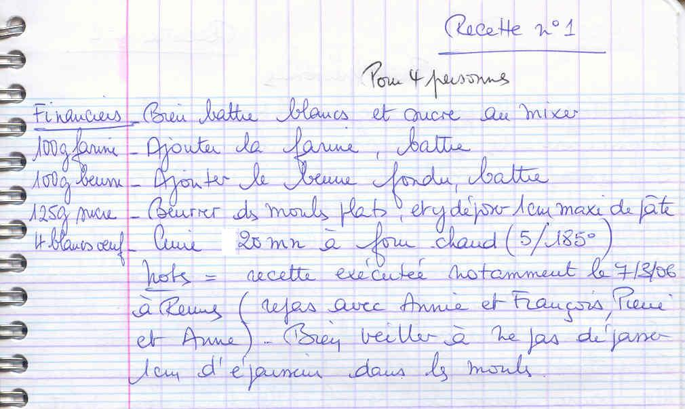

## Ingrédients (pour 4 personnes)

- 100 g de farine
- 100 g de beurre
- 125 g de sucre
- 4 blancs d'oeufs

## Préparation

- bien battre les blancs et le sucre au mixer
- ajouter la farine, battre
- ajouter le beurre fondu, battre
- beurrer des moules plats, et y déposer 1 cm maximum de pâte
- cuire 20 mn à four chaud (th 5 / 185°C)

## Observations

- recette exécutée notamment le 7/3/06 à Rennes (repas avec Annie et François, Pierre et Anne).
- bien veiller à ne pas dépasser 1 cm d'épaisseur dans les moules.
