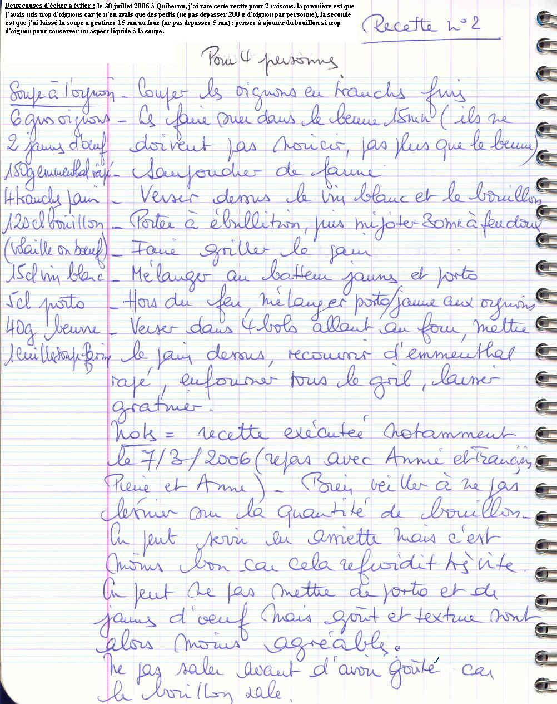

## Ingrédients (pour 4 personnes)

- 6 gros oignons (pas plus de 200 g par personne)
- 2 jaunes d'oeufs
- 150 g d'emmenthal râpé
- 4 tranches de pain
- 120 cl de bouillon (volaille ou boeuf)
- 15 cl de vin blanc
- 5 cl de porto
- 40 g de beurre
- 1 cuillère à soupe de farine

## Préparation

- couper les oignons en tranches fines
- les faire suer dans le beurre 15 mn (ils ne doivent pas noircir, pas plus que le beurre)
- saupoudrer de farine
- verser dessus le vin blanc et le bouillon
- porter à ébullition, puis faire mijoter 30 mn à feu doux
- faire griller le pain
- mélanger au batteur les jaunes et le porto
- hors du feu, mélanger le mélange porto/jaunes aux oignons
- verser dans 4 bols allant au four, mettre le pain dessus, recouvrir d'emmenthal râpé, enfourner sous le gril et laisser gratiner

## Observations

- Deux causes d'échec à éviter : le 30 juillet 2006 à Quiberon, j'ai raté cette recette pour 2 raisons, la première est que j'avais mis trop d'oignons car je n'en avais que des petits (ne pas dépasser 200 g d'oignon par personne), la seconde est que j'ai laissé la soupe à gratiner 15 mn au four (ne pas dépasser 5 mn) ; penser à ajouter du bouillon si trop d'oignon pour conserver un aspect liquide à la soupe.
- Recette exécutée notamment le 7/3/2006 (repas avec Annie et François, Pierre et Anne).
- Bien veiller à ne pas lésiner sur la quantité de bouillon.
- On peut servir en assiette mais c'est moins bon car cela refroidit très vite.
- On peut ne pas mettre de porto et de jaunes d'oeuf mais goût et texture sont alors moins agréables.
- Ne pas saler avant d'avoir goûté car le bouillon sale.
