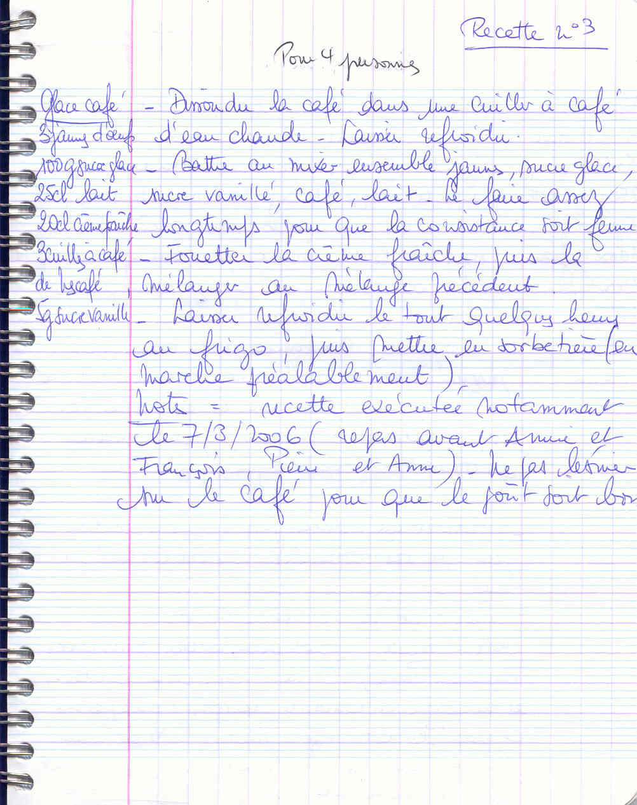

## Ingrédients (pour 4 personnes)

- 3 jaunes d'oeufs
- 100 g de sucre glace
- 25 cl de lait
- 20 cl de crème fraîche
- 3 cuillères à café de Nescafé
- 5 g de sucre vanillé

## Préparation

- dissoudre le café dans une cuiller à café d'eau chaude, laisser refroidir
- battre au mixer ensemble les jaunes, le sucre glace, le sucre vanillé, le café et le lait ; le faire assez longtemps pour que la consistance soit ferme
- fouetter la crème fraîche, puis la mélanger délicatement au mélange précédent
- laisser refroidir le tout quelques heures au réfrigérateur, puis mettre en sorbetière (mise en marche préalablement)

## Observations

- recette exécutée notamment le 7/3/2006 (repas avant Annie et François, Pierre et Anne).
- ne pas lésiner sur le café pour que le goût soit bien prononcé.
