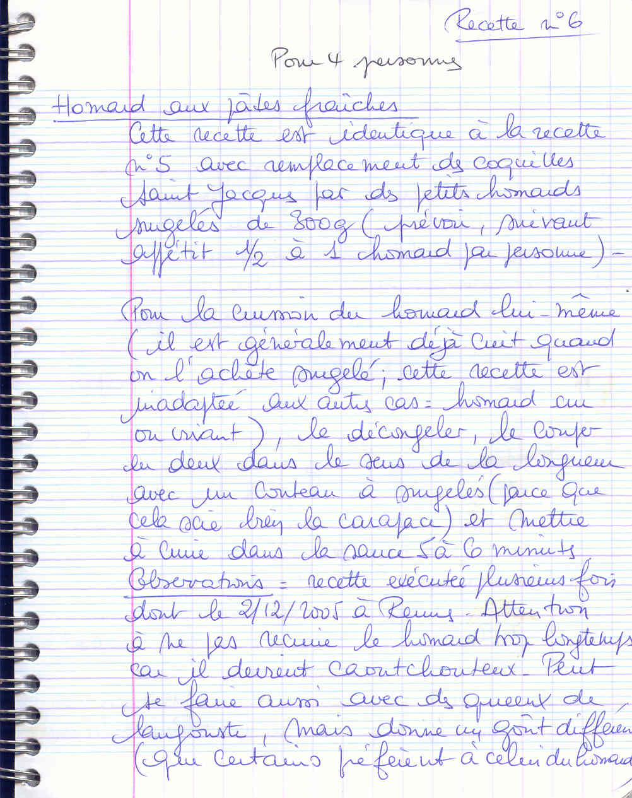

## Ingrédients (pour 4 personnes)

- 2 à 4 petits homards surgelés de 300 g (selon l'appétit, 1/2 à 1 homard par personne)
- sauce armoricaine (identique à la [recette n° 5](/pjpcode/recipes/0005/recipe.html) : crème fraîche, beurre, carotte, échalotes, estragon, cognac, vin blanc, céleri, concentré de tomate, thym, laurier)
- 250 g de pâtes fraîches (ou spaghetti)
- huile d'olive, sel et poivre
- 1 gousse d'ail

## Préparation

- préparer la sauce armoricaine selon les indications de la [recette n° 5](/pjpcode/recipes/0005/recipe.html)
- pour le homard lui-même (généralement déjà cuit à l'achat surgelé ; cette recette est inadaptée au homard cru ou vivant) : le décongeler, le couper en deux dans la longueur avec un couteau à surgelés pour bien scier la carapace
- mettre le homard à cuire dans la sauce chaude pendant 5 à 6 minutes
- faire cuire les pâtes fraîches (2 à 3 minutes dans l'eau bouillante salée avec un filet d'huile d'olive)
- égoutter les pâtes, les mélanger avec l'ail haché et un peu de sauce
- disposer les demi-homards sur les pâtes, napper de sauce et servir aussitôt

## Observations

- recette exécutée plusieurs fois dont le 2/12/2005 à Rennes.
- attention à ne pas recuire le homard trop longtemps car il devient caoutchouteux.
- peut se réaliser également avec des queues de langouste, ce qui donne un goût différent (parfois préféré à celui du homard).
