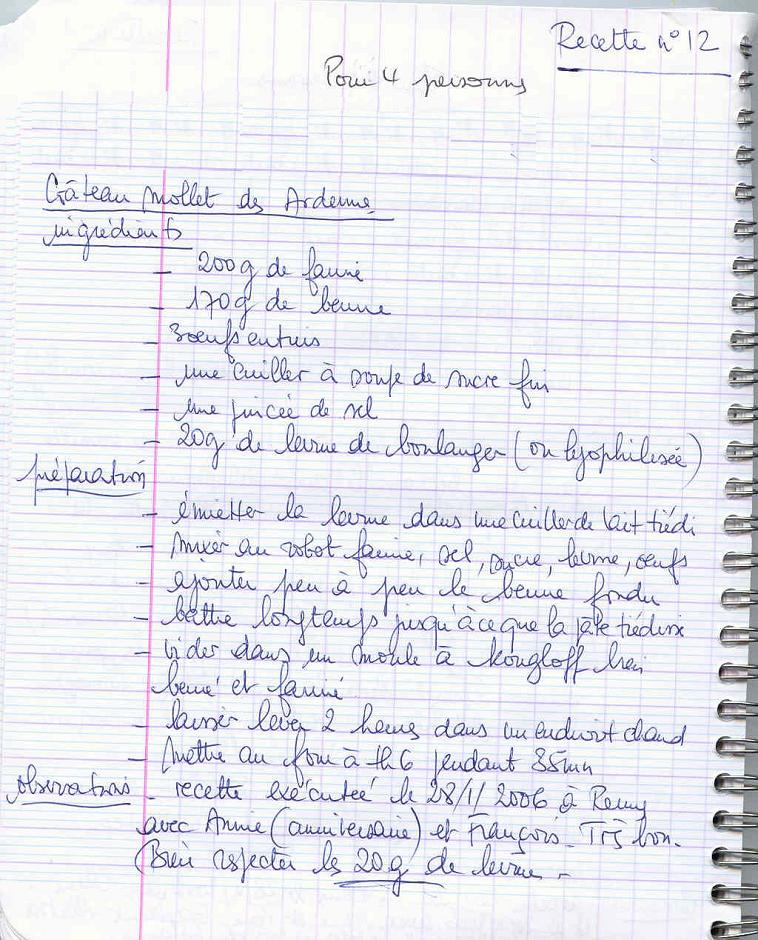

## Ingrédients

- 200 g de farine
- 170 g de beurre mou
- 3 œufs
- 1 c. à soupe de sucre fin
- 1 pincée de sel
- 20 g de levure de boulanger
- 2 à 3 c. à soupe de lait tiède

## Préparation

1. **Levure :** Délayer la levure de boulanger dans 2 à 3 cuillères à soupe de lait tiède.
2. **Pâte :** Dans une terrine ou au robot, mélanger la farine, le sucre fin, la pincée de sel et les œufs entiers. Bien battre la pâte jusqu'à ce qu'elle devienne élastique.
3. **Beurre :** Incorporer ensuite la levure délayée, puis le beurre mou coupé en morceaux. Pétrir soigneusement pour obtenir une pâte lisse et souple.
4. **Repos :** Beurrer un moule à brioche ou à savarin cannelé. Y verser la pâte et laisser lever dans un endroit tiède à l'abri des courants d'air pendant environ 2 heures (la pâte doit doubler de volume).
5. **Cuisson :** Cuire à four chaud (thermostat 6 / 180°C) pendant environ 35 minutes. Démouler tiède sur une grille.
