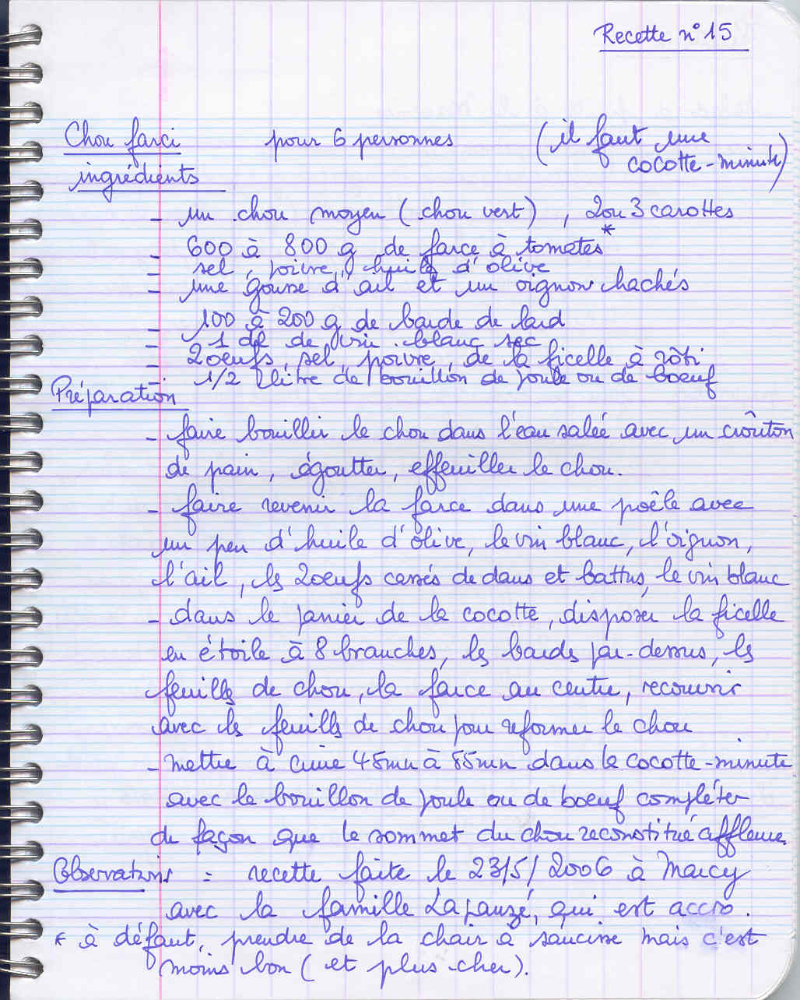

## Ingrédients

- 1 chou vert moyen frisé
- 600 g à 800 g de chair à saucisse ou farce à tomates
- 2 à 3 carottes
- 2 gousses d'ail
- 1 gros oignon
- 100 g à 200 g de barde de lard
- 1 dl de vin blanc sec
- 1/2 l de bouillon de volaille ou bœuf
- 2 œufs
- Sel, poivre, persil haché
- Ficelle de cuisine pour rôtir

## Préparation

1. **Préparation du chou :** Blanchir le chou entier dans une grande marmite d'eau bouillante salée pendant 10 à 15 minutes. Égoutter soigneusement et rafraîchir à l'eau froide. Ouvrir délicatement les feuilles sans les détacher pour dégager le cœur. Retirer le cœur dur et le hacher finement.
2. **Farce :** Dans une jatte, mélanger la chair à saucisse, l'ail écrasé, l'oignon haché, le cœur de chou haché, le persil et les 2 œufs. Saler et poivrer.
3. **Façonnage :** Déposer une boule de farce au centre du chou, puis reformer le chou en intercalant un peu de farce entre les premières rangées de feuilles. Envelopper le chou de bardes de lard et ficeler soigneusement en croisillons serrés comme un rôti.
4. **Cuisson :** Dans une cocotte (ou cocotte-minute), faire revenir les carottes en rondelles avec un peu de matière grasse. Déposer le chou ficelé. Mouiller avec 1 dl de vin blanc et 1/2 litre de bouillon chaud.
5. **Mijotage :** Fermer la cocotte et cuire à feu doux pendant 1h15 à 1h30 (ou 45 à 55 minutes en cocotte-minute après sifflement).
6. **Service :** Couper et retirer la ficelle, découper le chou farci en tranches épaisses comme un gâteau et napper du jus de cuisson réduit.
