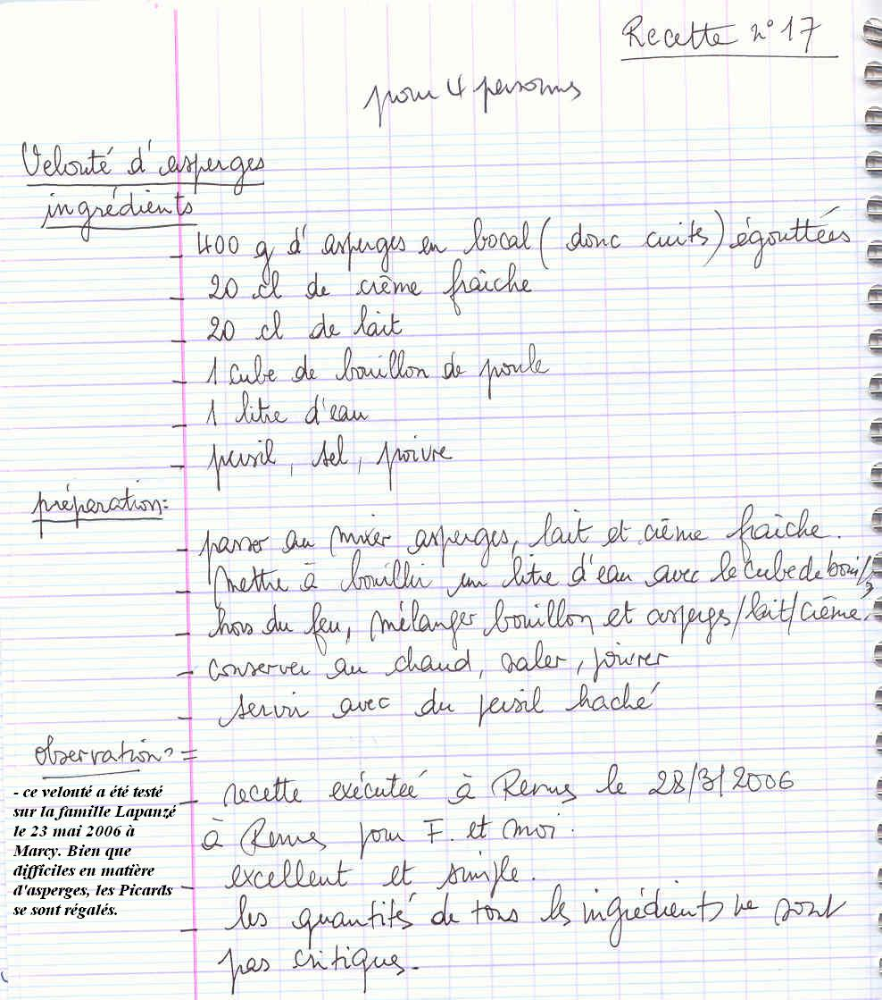
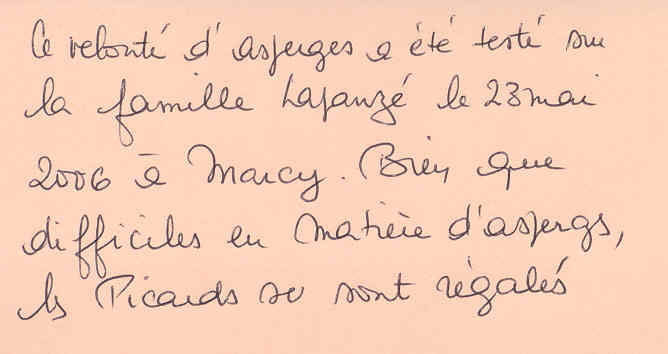

*Pour 4 personnes*

## Ingrédients

- 400 g d'asperges en bocal (cuites), égouttées
- 20 cl de crème fraîche
- 20 cl de lait
- 1 cube de bouillon de poule
- 1 litre d'eau
- Persil haché
- Sel, poivre

## Préparation

1. **Mixage :** Passer au mixeur les asperges égouttées avec le lait et la crème fraîche jusqu'à consistance bien lisse.
2. **Bouillon :** Dans une casserole, porter à ébullition 1 litre d'eau avec le cube de bouillon de poule.
3. **Mélange :** Hors du feu, incorporer la purée d'asperges au bouillon chaud en remuant.
4. **Finition :** Réchauffer doucement sans faire bouillir. Saler et poivrer au goût.
5. **Service :** Servir bien chaud parsemé de persil frais haché.

> **Observations :** Recette exécutée à Rennes le 28/03/2006 pour F. et moi : excellent et simple. Les quantités de tous les ingrédients ne sont pas critiques.
>
> *Note :* Ce velouté a été testé sur la famille Lapanzé le 23 mai 2006 à Marcy. Bien que difficiles en matière d'asperges, les Picards se sont régalés.
