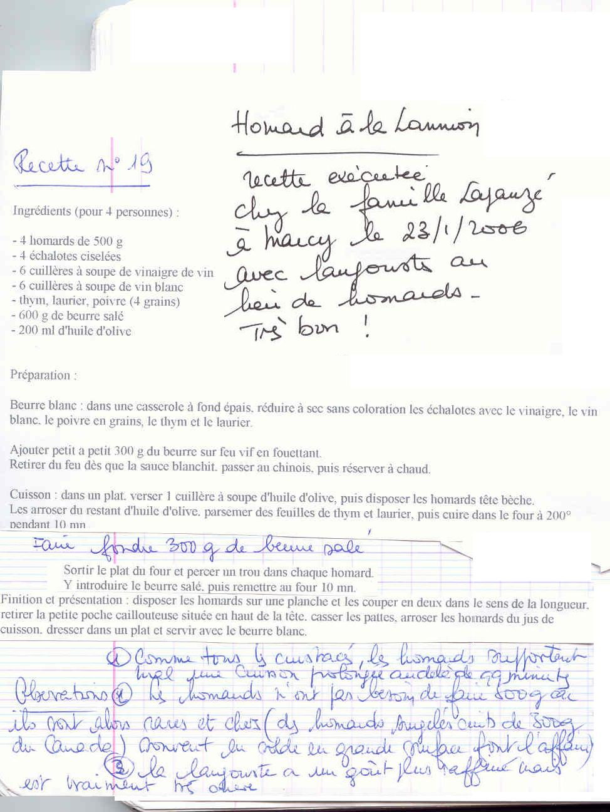

*Pour 4 personnes*

## Ingrédients

- 4 homards de 500 g (ou homards surgelés cuits du Canada)
- 4 échalotes ciselées
- 6 c. à soupe de vinaigre de vin
- 6 c. à soupe de vin blanc
- 600 g de beurre salé (300 g pour la sauce, 300 g pour la cuisson)
- 200 ml d'huile d'olive
- Thym, laurier
- 4 grains de poivre

## Préparation

1. **Beurre blanc :** Dans une casserole à fond épais, réduire à sec sans coloration les échalotes ciselées avec le vinaigre, le vin blanc, les grains de poivre, le thym et le laurier. Hors du feu ou sur feu très doux, incorporer progressivement 300 g de beurre salé bien froid coupé en dés en fouettant vivement. Dès que la sauce émulsionne et blanchit, passer au chinois et réserver au chaud.
2. **Cuisson au four :** Dans un grand plat allant au four, verser 1 cuillère à soupe d'huile d'olive et disposer les homards tête-bêche. Les arroser avec le restant d'huile d'olive et parsemer de thym et de laurier. Enfourner à 200°C pendant 10 minutes.
3. **Beurre fondu :** Faire fondre les 300 g de beurre salé restants. Sortir le plat, percer une ouverture sur le dos de chaque homard, y verser le beurre salé fondu et remettre au four pour 10 minutes supplémentaires.
4. **Dressage :** Fendre les homards en deux dans le sens de la longueur. Retirer la poche caillouteuse à l'avant de la tête, concasser légèrement les pinces. Arroser du jus de cuisson du plat et servir aussitôt accompagné du beurre blanc.

> **Observations :**
> - Recette exécutée chez la famille Lapanzé à Marcy le 23/01/2006 avec des langoustes au lieu de homards. Très bon !
> - Comme tous les crustacés, le homard supporte mal la surcuisson.
> - Des homards de 300 g conviennent parfaitement si les 500 g sont trop onéreux. La langouste est encore plus raffinée mais nettement plus chère.
