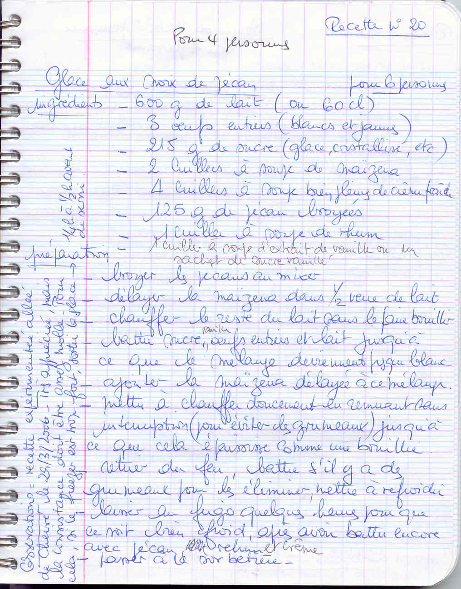

*Pour 4 à 6 personnes*

## Ingrédients

- 60 cl de lait (600 g)
- 3 œufs entiers
- 215 g de sucre
- 2 c. à soupe de Maïzena
- 4 c. à soupe bien pleines de crème fraîche
- 125 g de noix de pécan broyées
- 1 c. à soupe de rhum
- 1 c. à soupe d'extrait de vanille (ou 1 sachet de sucre vanillé)

## Préparation

1. **Préparation des ingrédients :** Hacher ou broyer les noix de pécan au mixeur. Délayer la Maïzena dans un demi-verre de lait froid.
2. **Base crème :** Faire tiédir le reste du lait sans bouillir. Dans un récipient, battre les œufs entiers avec le sucre et la vanille jusqu'à ce que le mélange blanchisse. Incorporer la Maïzena délayée.
3. **Cuisson :** Verser le lait tiède sur la préparation en fouettant, puis remettre sur feu doux. Cuire sans cesser de remuer jusqu'à ce que la crème épaississe (consistance d'une crème anglaise épaisse ou bouillie légère).
4. **Refroidissement :** Retirer du feu et fouetter vivement pour lisser. Laisser refroidir complètement à température ambiante, puis incorporer la crème fraîche, le rhum et les noix de pécan broyées. Réserver au réfrigérateur plusieurs heures jusqu'à ce que l'appareil soit bien froid.
5. **Turbinage :** Passer la préparation à la sorbetière.

> **Observations :** Recette expérimentée allée de Chevreuse le 29/03/2006. Très appréciée ! La consistance doit rester moelleuse. Si le congélateur est très froid, sortir la glace 15 à 30 minutes avant de la déguster.
