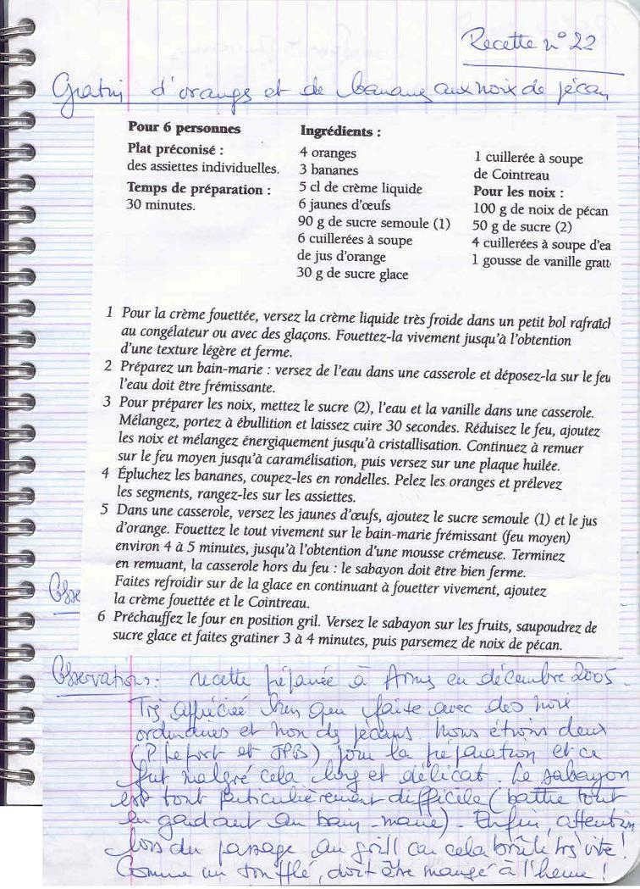

*Pour 6 personnes — Préparation : 30 minutes*

## Ingrédients

### Fruits et sabayon
- 4 oranges
- 3 bananes
- 6 jaunes d'œufs
- 90 g de sucre semoule
- 6 c. à soupe de jus d'orange
- 5 cl de crème liquide très froide
- 1 c. à soupe de Cointreau
- 30 g de sucre glace (pour gratiner)

### Noix caramélisées
- 100 g de noix de pécan (ou noix classiques)
- 50 g de sucre
- 4 c. à soupe d'eau
- 1 gousse de vanille grattée

## Préparation

1. **Crème fouettée :** Fouetter la crème liquide très froide dans un bol préalablement rafraîchi jusqu'à l'obtention d'une chantilly légère et ferme. Réserver au frais.
2. **Noix caramélisées :** Dans une casserole, mélanger les 50 g de sucre, l'eau et les grains de vanille. Porter à ébullition 30 secondes. Ajouter les noix de pécan et remuer vivement jusqu'au sablage puis à la caramélisation dorée. Débarrasser sur une plaque huilée et laisser refroidir.
3. **Fruits :** Peler les oranges à vif et prélever les suprêmes. Éplucher les bananes et les couper en rondelles. Disposer les fruits dans des assiettes ou plats individuels allant au four.
4. **Sabayon à l'orange :** Dans un cul-de-poule au bain-marie frémissant, fouetter vivement les jaunes d'œufs avec les 90 g de sucre et le jus d'orange pendant 4 à 5 minutes jusqu'à ce que le sabayon prenne du volume et devienne mousseux et onctueux. Retirer du bain-marie, fouetter sur un lit de glaçons pour refroidir, puis incorporer délicatement la crème fouettée et le Cointreau.
5. **Gratinage :** Napper les fruits de sabayon, poudrer de sucre glace et passer sous le gril du four bien chaud pendant 3 à 4 minutes en surveillant attentivement.
6. **Finition :** Parsemer aussitôt des éclats de noix de pécan caramélisées et servir sans attendre.

> **Observations :** Recette préparée à Rennes en décembre 2005. Très appréciée, bien que faite avec des noix ordinaires et non des pécans. Nous étions deux (P. Lefort et JPB) pour la préparation et ce fut malgré cela long et délicat. Le sabayon est tout particulièrement difficile (battre constamment au bain-marie). Attention sous le grill : cela brûle très vite ! À servir immédiatement comme un soufflé.
