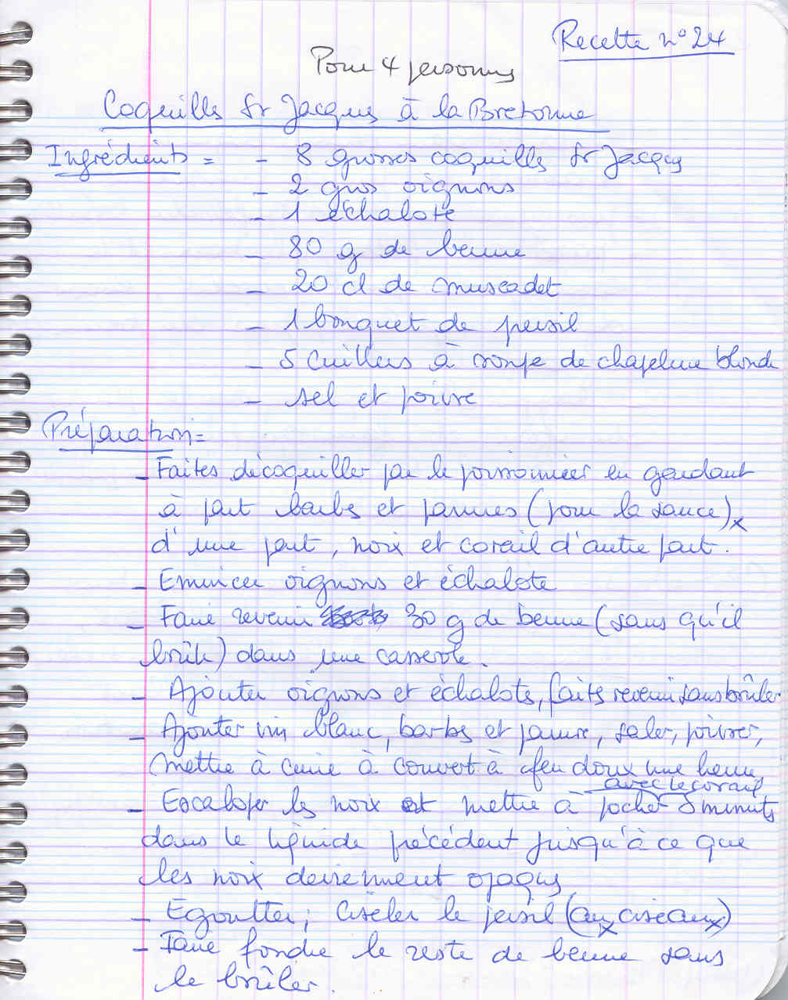
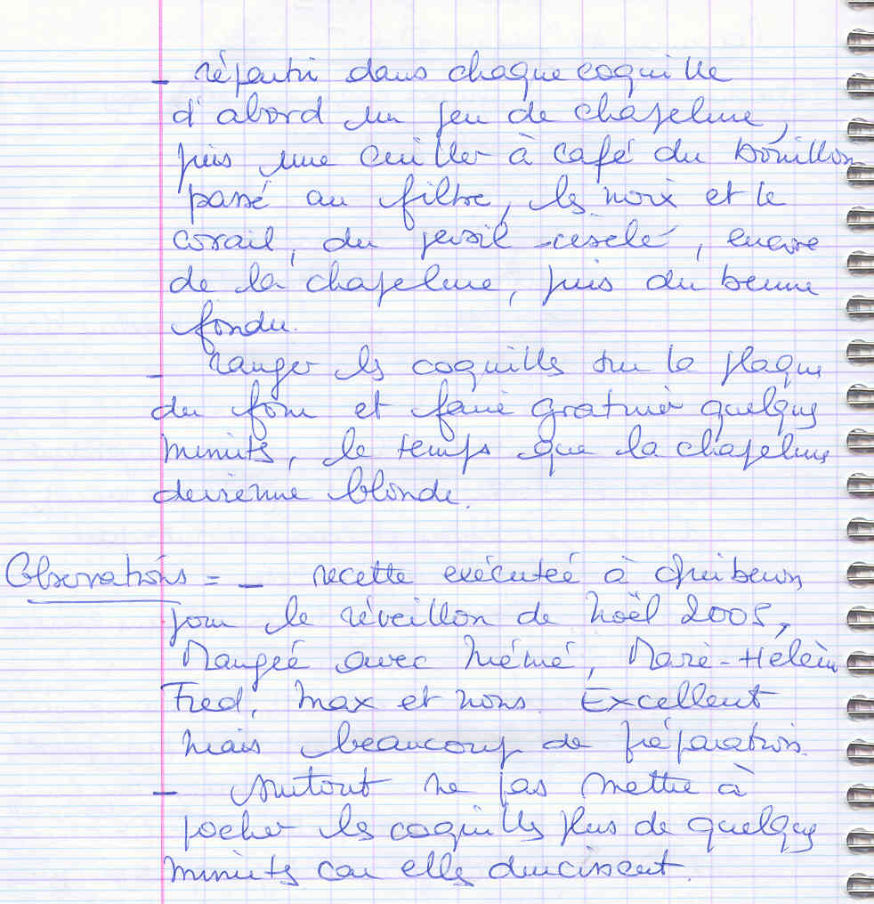

*Pour 4 personnes*

## Ingrédients

- 8 grosses coquilles Saint-Jacques (garder les coquilles creuses nettoyées)
- 2 gros oignons
- 1 échalote
- 80 g de beurre (30 g pour la sauce, 50 g pour gratiner)
- 20 cl de Muscadet (vin blanc sec)
- 1 bouquet de persil frais
- 5 c. à soupe de chapelure blonde
- Sel, poivre

## Préparation

1. **Préparation des coquilles :** Faire ouvrir par le poissonnier en conservant d'une part les noix et le corail, et d'autre part les bardes bien lavées.
2. **Fumet aux bardes :** Émincer les oignons et l'échalote. Dans une casserole, faire fondre 30 g de beurre et suer les oignons et l'échalote sans coloration. Ajouter le vin blanc, les bardes nettoyées, du sel et du poivre. Couvrir et laisser mijoter à feu doux pendant 1 heure.
3. **Pochage des noix :** Escaloper les noix de Saint-Jacques en deux ou trois disques. Les plonger avec le corail dans le court-bouillon frémissant pendant 3 à 5 minutes seulement, jusqu'à ce que la chair devienne opaque. Égoutter aussitôt (ne pas surcuire pour éviter qu'elles ne durcissent). Filtrer le bouillon de cuisson.
4. **Montage :** Disposer les coquilles creuses sur la plaque du four. Dans le fond de chaque coquille, déposer une pincée de chapelure, une cuillère à café de bouillon filtré, les morceaux de noix et corail, puis saupoudrer de persil fraîchement ciselé.
5. **Gratinage :** Couvrir d'une nouvelle couche de chapelure blonde et arroser généreusement avec les 50 g de beurre restant préalablement fondu. Enfourner sous le gril bien chaud quelques minutes jusqu'à ce que la chapelure soit dorée et croustillante. Servir très chaud.

> **Observations :** Recette exécutée à Quiberon pour le réveillon de Noël 2005 avec Mémé, Marie-Hélène, Fred, Max et nous : excellent, mais demande un peu de préparation ! Surtout, ne pas pocher les Saint-Jacques plus de quelques minutes sous peine de les rendre caoutchouteuses.
