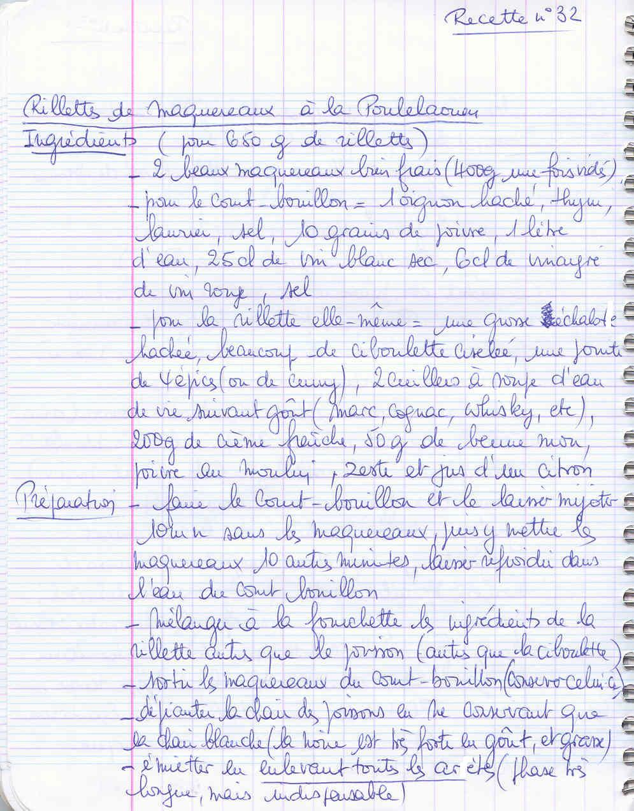
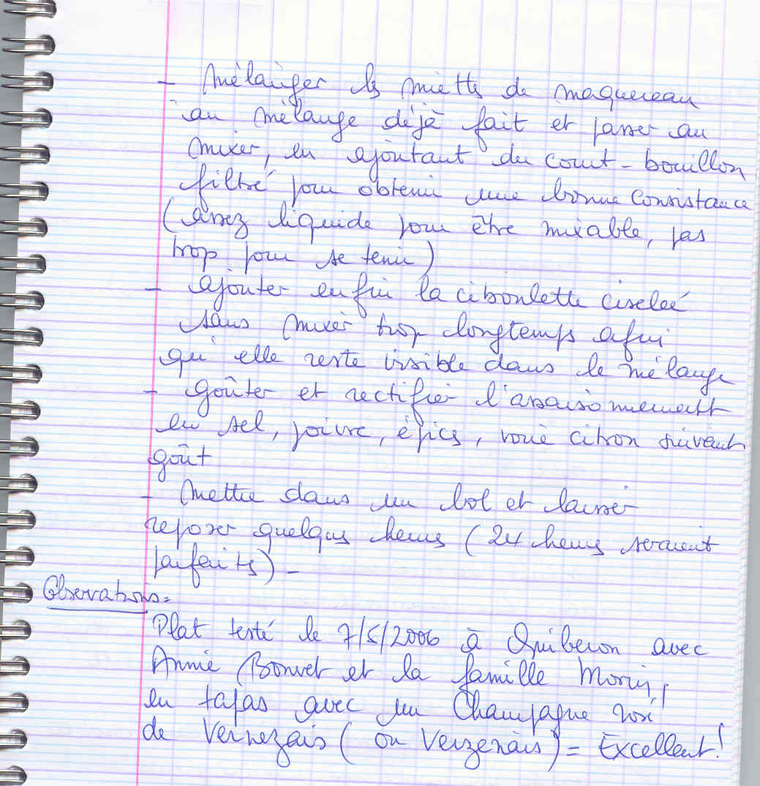
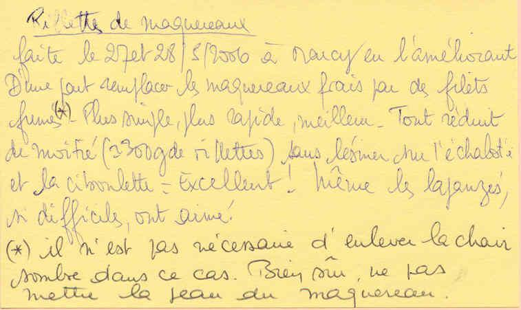

*Pour environ 650 g de rillettes*

## Ingrédients

### Poisson et court-bouillon
- 2 beaux maquereaux bien frais (environ 400 g vidés)
- 1 litre d'eau
- 25 cl de vin blanc sec
- 6 cl de vinaigre de vin rouge
- 1 oignon haché
- Thym, laurier, sel, 10 grains de poivre

### Liaison et aromates
- 200 g de crème fraîche
- 50 g de beurre mou
- 1 grosse échalote très finement hachée
- 1 gros bouquet de ciboulette fraîche ciselée
- 1 citron (jus pressé et zeste râpé)
- 1 pointe de 4-épices (ou curry)
- 2 c. à soupe d'eau-de-vie (marc, cognac ou whisky)
- Poivre du moulin, sel fin

## Préparation

1. **Court-bouillon :** Dans une grande casserole, réunir l'eau, le vin blanc, le vinaigre, l'oignon, le thym, le laurier, le sel et les grains de poivre. Laisser frémir 10 minutes.
2. **Pochage :** Plonger les maquereaux dans le court-bouillon frémissant et cuire 10 minutes. Couper le feu et laisser refroidir les poissons dans leur bouillon.
3. **Préparation des chairs :** Égoutter les maquereaux (garder un peu de bouillon filtré). Retirer la peau et les arêtes avec le plus grand soin. Ne conserver que la chair blanche (ôter les bandes de chair brune, trop grasses et puissantes). Émietter à la main.
4. **Appareil :** Dans une jatte, mélanger le beurre pommade, la crème fraîche, l'échalote hachée, le zeste et jus de citron, les 4-épices et l'eau-de-vie.
5. **Mixage :** Incorporer les miettes de maquereau. Mixer par à-coups en ajoutant quelques cuillerées de court-bouillon filtré jusqu'à obtenir une texture tartinable onctueuse.
6. **Touche finale :** Ajouter la ciboulette ciselée et mélanger délicatement à la spatule pour ne pas la broyer. Rectifier le sel et le poivre.
7. **Repos :** Mettre en terrine ou pot et laisser reposer au frais au moins quelques heures (l'idéal étant 24 heures).

> **Observations :** Dégusté en tapas le 07/05/2006 à Quiberon avec Annie Bonvet et la famille Morin, accompagné d'un Champagne rosé de Verzenay : excellent !
>
> *Variante rapide au maquereau fumé :* Testée à Marcy en mai 2006 en remplaçant le maquereau frais poché par des filets de maquereaux fumés au poivre (sans la peau, inutile d'enlever la chair sombre). Réalisation express, texture parfaite et plébiscitée par toute la famille !
