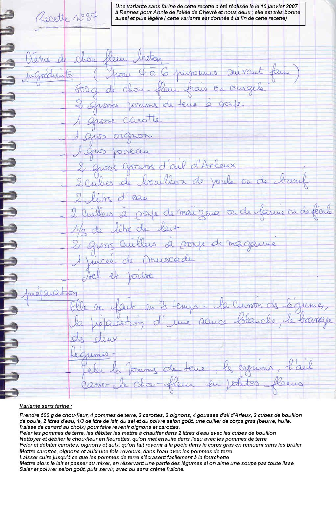
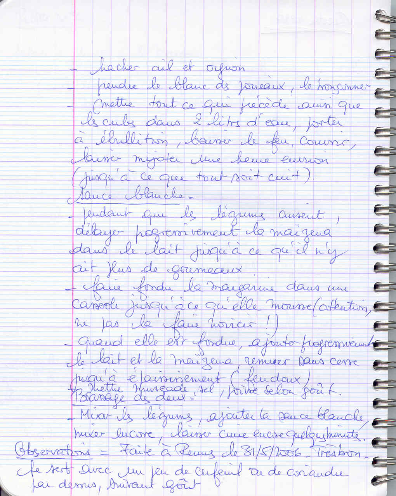

*Pour 4 à 6 personnes*

## Ingrédients

### Les légumes et bouillon
- 500 g de chou-fleur (frais ou surgelé)
- 2 grosses pommes de terre
- 1 grosse carotte
- 1 gros poireau (le blanc)
- 1 gros oignon
- 2 grosses gousses d'ail d'Arleux
- 2 cubes de bouillon de volaille ou de bœuf
- 2 litres d'eau

### La sauce blanche de liaison
- 2 c. à soupe de Maïzena (ou farine)
- 33 cl de lait (1/3 de litre)
- 2 grosses c. à soupe de beurre (ou margarine)
- 1 pincée de noix de muscade râpée
- Sel, poivre
- Cerfeuil ou coriandre fraîche pour le service

## Préparation

1. **Cuisson des légumes :** Peler les pommes de terre, la carotte, l'oignon et l'ail. Détailler le chou-fleur en petits bouquets et émincer le blanc de poireau. Dans un grand faitout, mettre tous les légumes, l'ail, l'oignon et les 2 cubes de bouillon dans 2 litres d'eau. Porter à ébullition, couvrir et laisser mijoter à feu doux pendant environ 1 heure jusqu'à ce que les légumes soient très tendres.
2. **Sauce blanche :** Délayer la Maïzena dans le lait froid. Dans une casserole, faire fondre le beurre à feu doux sans le colorer. Verser le mélange lait/Maïzena et cuire à feu doux sans cesser de fouetter jusqu'à épaississement. Assaisonner avec le sel, le poivre et la muscade.
3. **Mixage et assemblage :** Mixer finement les légumes cuits dans leur bouillon à l'aide d'un mixeur plongeant. Verser la sauce blanche dans le velouté, mixer à nouveau pour obtenir une texture crémeuse et veloutée. Laisser frémir 2 à 3 minutes supplémentaires.
4. **Service :** Servir bien chaud parsemé de pluches de cerfeuil ou de coriandre.

> **Observations :** Réalisée à Rennes le 31/05/2006 : un velouté très doux et réconfortant.
>
> *Variante plus légère sans farine :* Testée le 10/01/2007 pour Annie (de l'allée de Chevré) : porter les pommes de terre à 4 pièces, faire suer les carottes et oignons à la graisse de canard, cuire les légumes dans le bouillon et lier simplement au lait et au mixeur (sans sauce blanche à la farine).
