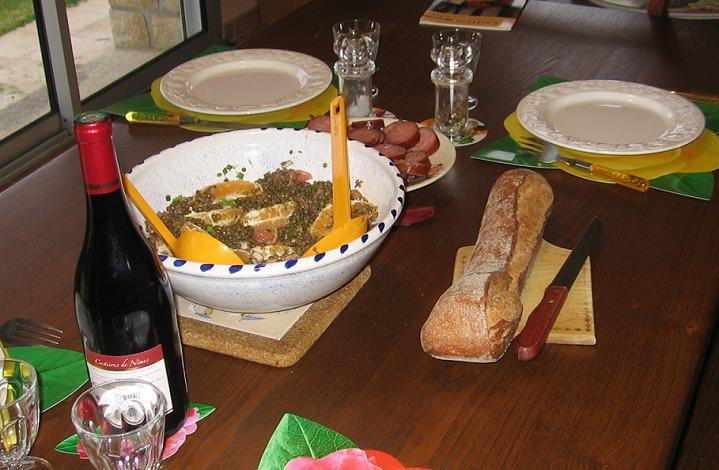
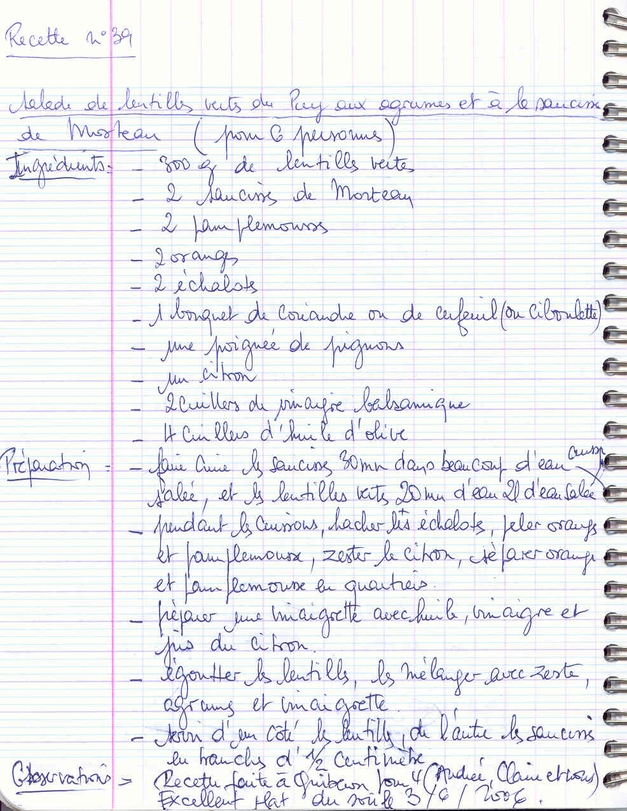

*Pour 6 personnes*

## Ingrédients

- 300 g de lentilles vertes du Puy
- 2 véritables saucisses de Morteau
- 2 pamplemousses roses
- 2 oranges
- 1 citron non traité (zeste et jus)
- 2 échalotes
- 1 bouquet de coriandre fraîche (ou cerfeuil / ciboulette)
- 1 poignée de pignons de pin dorés
- 4 c. à soupe d'huile d'olive
- 2 c. à soupe de vinaigre balsamique
- Sel, poivre

## Préparation

1. **Cuisson des saucisses et lentilles :** Cuire les saucisses de Morteau à frémissement dans une grande casserole d'eau pendant 30 minutes sans les percer. Dans une autre casserole, cuire les lentilles vertes dans 2 litres d'eau frémissante salée pendant 20 à 25 minutes (elles doivent rester fermes).
2. **Agrumes et aromates :** Peler les oranges et les pamplemousses à vif, puis détacher délicatement les suprêmes (quartiers sans membrane). Prélever le zeste râpé fin et le jus du citron. Hacher finement les échalotes.
3. **Vinaigrette :** Dans un bol, émulsionner l'huile d'olive, le vinaigre balsamique, le jus de citron, du sel et du poivre.
4. **Assemblage tiède :** Égoutter les lentilles encore tièdes, les mélanger aussitôt avec les échalotes hachées, le zeste de citron, les suprêmes d'agrumes et la vinaigrette pour qu'elles s'imprègnent des saveurs.
5. **Dressage et service :** Découper les saucisses de Morteau chaudes en rondelles d'un demi-centimètre. Disposer la salade de lentilles aux agrumes, parsemer de pignons grillés et de coriandre fraîche ciselée, et entourer des rondelles de saucisse.

> **Observations :** Recette préparée à Quiberon pour 4 (Andrée, Claire et nous deux) le 03/06/2006 : un régal complet et plein de fraîcheur pour le soir !
