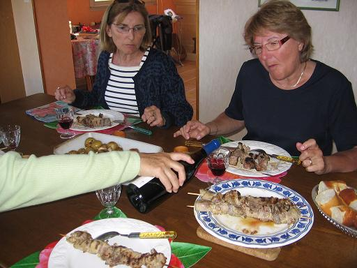
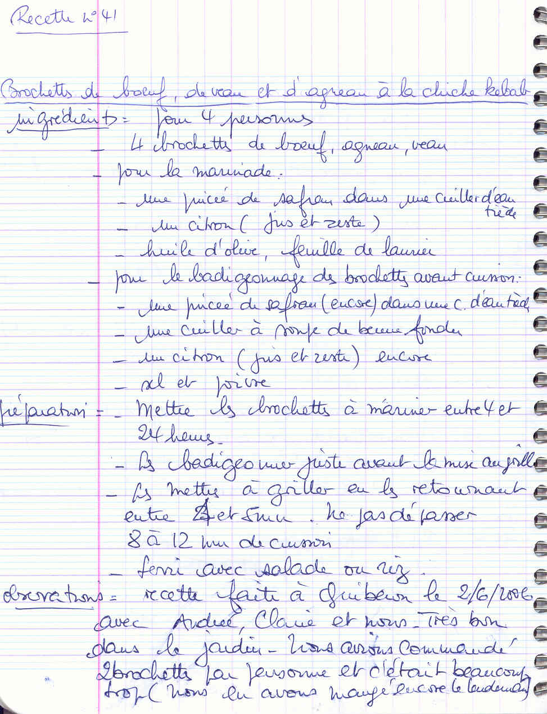

*Pour 4 personnes*

## Ingrédients

- 4 belles brochettes mixtes (morceaux de bœuf, d'agneau et de veau)

### Pour la marinade
- 1 citron non traité (jus et zeste)
- 1 pincée de safran infusé dans 1 c. à soupe d'eau tiède
- 4 c. à soupe d'huile d'olive
- 2 feuilles de laurier émiettées

### Pour le badigeonnage et la finition
- 1 pincée de safran infusé dans 1 c. à soupe d'eau tiède
- 1 c. à soupe de beurre fondu
- 1 citron (jus et zeste râpé)
- Sel fin, poivre du moulin

## Préparation

1. **Marinade :** Dans un grand plat creux, mélanger l'huile d'olive, l'infusion de safran, le zeste et le jus de citron, et les feuilles de laurier. Y déposer les brochettes, bien les enrober, couvrir et laisser mariner au frais de 4 à 24 heures.
2. **Beurre safrané :** Préparer le badigeon en mélangeant le beurre fondu, la seconde dose de safran infusé, le zeste et le jus de citron, du sel et du poivre.
3. **Badigeonnage et cuisson :** Égoutter les brochettes. Les enduire généreusement au pinceau avec le beurre safrané. Les poser sur la braise vive du barbecue (ou sous le gril très chaud).
4. **Temps de cuisson :** Faire griller 8 à 12 minutes au total, en les retournant toutes les 4 à 5 minutes et en les badigeonnant régulièrement pour conserver une viande bien juteuse et parfumée.
5. **Service :** Servir aussitôt avec du riz basmati ou une belle salade fraîche.

> **Observations :** Réalisé à Quiberon le 02/06/2006 dans le jardin avec Andrée, Claire et nous : un délice ! Attention aux portions : 1 grosse brochette par personne est amplement suffisante.
