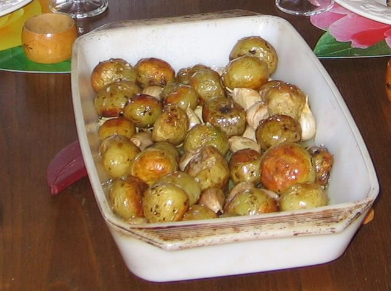
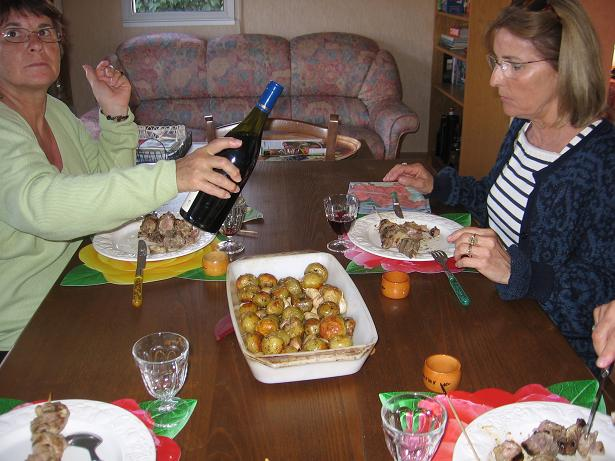

*Pour 4 personnes*

📄 *[Consulter la recette manuscrite originale](image-03.jpg)*

## Ingrédients

- 16 petites pommes de terre fermes type rattes ou grenailles (laissées avec leur peau)
- 32 gousses d'ail d'Arleux fumé entières (non pelées, « en chemise »)
- Huile d'olive vierge extra
- Gros sel de mer, poivre du moulin

## Préparation

1. **Préparation des légumes :** Brosser soigneusement les petites pommes de terre sous l'eau froide et les sécher. Ne pas les éplucher. Séparer les gousses d'ail de la tête sans retirer leur peau protectrice.
2. **Assaisonnement :** Déposer les pommes de terre et les gousses d'ail dans un grand plat à rôtir en une seule couche.
3. **Huile et sel :** Arroser généreusement d'huile d'olive, parsemer d'une belle poignée de gros sel de mer et donner quelques tours de moulin à poivre. Bien mélanger avec les mains pour bien enrober chaque pomme de terre.
4. **Rôtissage :** Enfourner à four très chaud (200°C à 220°C / 400°F à 425°F) pendant environ 30 à 40 minutes, en remuant le plat à mi-cuisson. Les pommes de terre doivent être dorées, croustillantes à l'extérieur et fondantes à cœur, et les gousses d'ail confites comme de la crème.
5. **Service :** Servir brûlant avec une belle salade verte croquante (on presse l'ail confit hors de sa peau directement sur les pommes de terre).

## Observations

- **Contexte :** Un classique très souvent préparé chez Isabelle, et cuisiné à Quiberon le 5 juin 2006 avec Andrée, Claire et nous : simplicité rustique et régal garanti !
