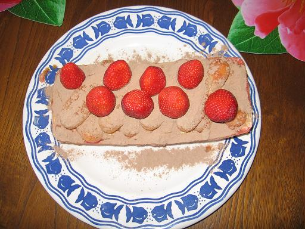
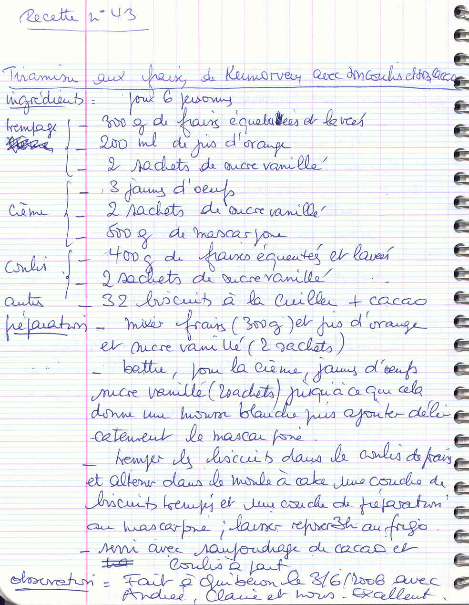

*Pour 6 personnes — Réfrigération : 3 heures minimum*

## Ingrédients

### Pour le sirop d'imbibition
- 300 g de fraises fraîches parfumées (de Kermorvan)
- 20 cl de jus d'orange
- 2 sachets de sucre vanillé

### Pour la crème mascarpone
- 500 g de mascarpone
- 3 jaunes d'œufs très frais
- 2 sachets de sucre vanillé

### Pour le coulis de fraises
- 400 g de fraises équeutées
- 2 sachets de sucre vanillé

### Pour le montage
- 32 biscuits à la cuillère
- Cacao amer en poudre (type Van Houten)

## Préparation

1. **Sirop de fraise à l'orange :** Laver, équeuter 300 g de fraises et les mixer finement avec les 20 cl de jus d'orange et 2 sachets de sucre vanillé. Verser dans une assiette creuse.
2. **Crème mascarpone :** Dans un saladier, fouetter les 3 jaunes d'œufs avec 2 sachets de sucre vanillé jusqu'à ce que l'appareil blanchisse et devienne mousseux. Détendre le mascarpone et l'incorporer délicatement au fouet pour obtenir une crème lisse et consistante.
3. **Coulis frais :** Mixer les 400 g de fraises restantes avec les 2 derniers sachets de sucre vanillé. Réserver au frais.
4. **Montage :** Tremper rapidement les biscuits à la cuillère dans le jus fraise-orange. Dans un plat rectangulaire ou un moule à cake tapissé de film, alterner une couche de biscuits imbibés et une couche généreuse de crème au mascarpone, en terminant par une couche de crème lissée.
5. **Prise au frais :** Réserver au réfrigérateur pendant au moins 3 heures (idéalement toute une nuit pour une tenue parfaite).
6. **Dressage :** Juste avant de servir, saupoudrer la surface d'un voile de cacao amer à travers une petite passoire. Servir bien frais en tranches ou à la cuillère, nappé du coulis de fraises fraîches.

> **Observations :** Réalisé à Quiberon le 03/06/2006 avec Andrée, Claire et nous : fraîcheur, onctuosité et parfum irrésistibles !
