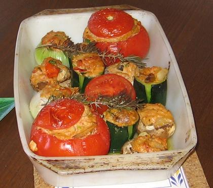
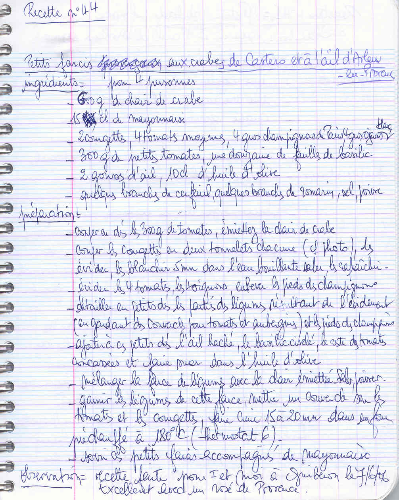

*Pour 4 personnes*

## Ingrédients

### Base et farce au crabe
- 600 g de chair de crabe (fraîche ou en boîte de qualité) émiettée
- 15 cl de mayonnaise maison bien ferme
- 300 g de petites tomates
- 12 feuilles de basilic frais
- 2 gousses d'ail d'Arleux hachées
- 10 cl d'huile d'olive
- Quelques brins de cerfeuil et de romarin
- Sel, poivre

### Légumes à farcir
- 2 courgettes bien rondes ou moyennes
- 4 tomates moyennes bien fermes
- 4 gros oignons blancs nouveaux
- 4 gros champignons de Paris à farcir

## Préparation

1. **Préparation des légumes :** 
   - Découper les courgettes en gros tronçons (« tonnelets »), les évider en laissant un fond et un chapeau. Les blanchir 5 minutes à l'eau bouillante salée puis les plonger dans l'eau glacée pour fixer la couleur.
   - Couper le chapeau des tomates et les évider délicatement.
   - Creuser le cœur des oignons blancs préalablement ébouillantés 5 minutes.
   - Retirer les pieds des champignons et brosser les têtes.
2. **Confection de la duxelles de légumes :** Hacher finement la pulpe extraite des courgettes, des oignons et les pieds de champignons. Découper les 300 g de petites tomates en petits dés. Faire suer l'ensemble à la poêle dans l'huile d'olive avec l'ail haché, le basilic ciselé et le romarin pendant 8 à 10 minutes pour évaporer l'eau végétale.
3. **Mélange de farce :** Laisser tiédir la tombée de légumes puis y incorporer la chair de crabe émiettée. Assaisonner de sel et de poivre.
4. **Montage et cuisson :** Garnir généreusement les courgettes, tomates, oignons et têtes de champignons avec la farce au crabe. Replacer leurs chapeaux respectifs sur les tomates et courgettes. Ranger dans un plat huilé allant au four et enfourner à 180°C (thermostat 6) pendant 15 à 20 minutes.
5. **Service :** Servir chaud ou tiède, accompagné d'une coupelle de mayonnaise maison et de cerfeuil frais.

> **Observations :** Réalisé pour F. et moi à Quiberon le 07/06/2006 : une alliance terre et mer remarquable, savourée avec un bon rosé de Provence bien frais !
