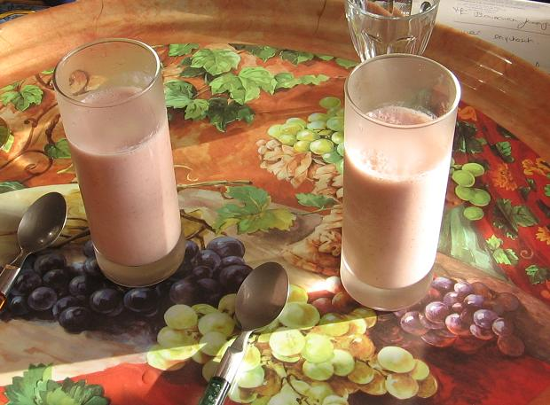
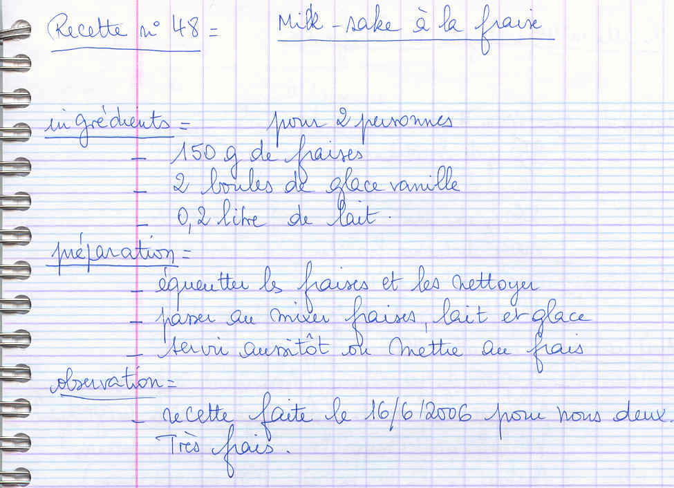

*Pour 2 personnes*

## Ingrédients

- 150 g de fraises fraîches bien parfumées
- 2 généreuses boules de glace à la vanille
- 20 cl (0,2 l) de lait entier ou demi-écrémé très frais

## Préparation

1. **Préparation des fruits :** Rincer rapidement les fraises, les égoutter, puis les équeuter.
2. **Mixage :** Placer les fraises, les boules de glace à la vanille et le lait bien froid dans le bol du blender ou du mixeur.
3. **Émulsion :** Mixer à haute vitesse pendant 1 minute jusqu'à l'obtention d'une boisson mousseuse, onctueuse et homogène.
4. **Service :** Verser dans de grands verres rafraîchis et déguster immédiatement avec une paille.

> **Observations :** Réalisé le 16/06/2006 pour nous deux : désaltérant, crémeux et très fruité !
