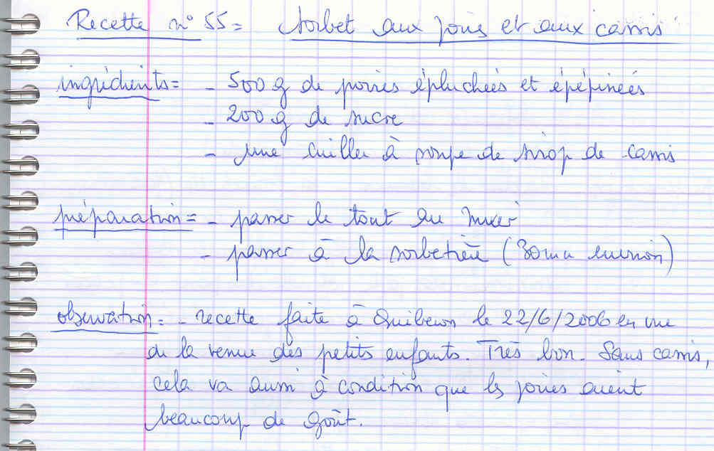

*Pour 4 à 6 personnes*

## Ingrédients

- 500 g de poires bien mûres (pelées et épépinées)
- 200 g de sucre en poudre
- 1 c. à soupe de crème ou sirop de cassis

## Préparation

1. **Purée de fruits :** Peler les poires, retirer le cœur et les pépins. Les couper en morceaux et les placer dans le bol du mixeur avec le sucre en poudre et la cuillère de sirop de cassis.
2. **Mixage :** Mixer très finement jusqu'à obtenir une purée de fruits parfaitement lisse et sirupeuse.
3. **Turbinage :** Verser la préparation dans la cuve de la sorbetière et turbiner pendant environ 30 minutes jusqu'à ce que le sorbet prenne une belle consistance glacée et soyeuse.
4. **Service :** Servir en boules dans des coupes rafraîchies, éventuellement décoré de quelques baies de cassis ou de groseilles.

> **Observations :** Réalisé à Quiberon le 22/06/2006 pour la venue des petits-enfants : grand succès ! Le sorbet peut aussi être préparé à la poire pure (sans cassis), à condition de choisir des poires extrêmement parfumées (type Williams ou Comice).
