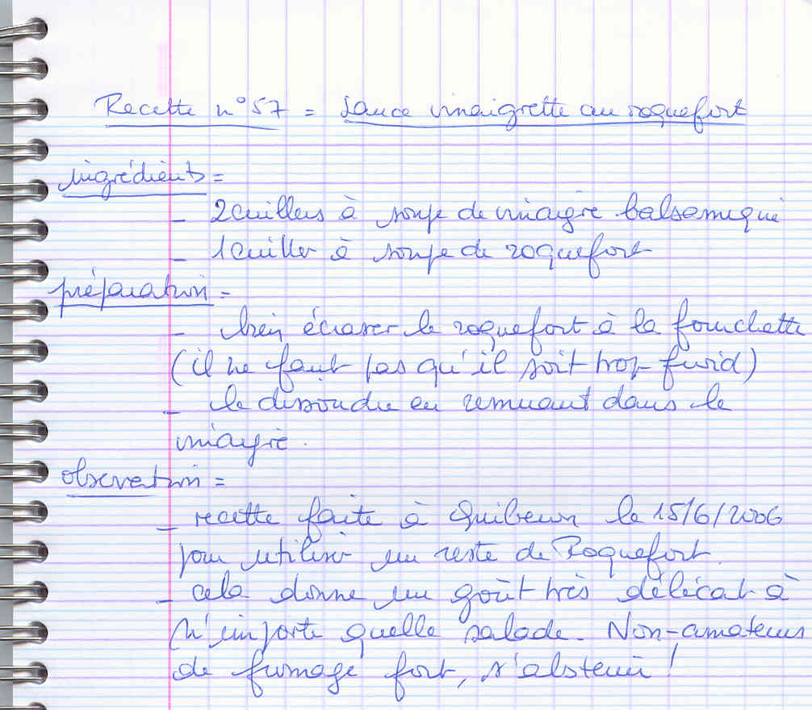

## Ingrédients

- 1 c. à soupe bombée de Roquefort à température ambiante (environ 30 à 40 g)
- 2 c. à soupe de vinaigre balsamique
- 4 c. à soupe d'huile d'olive (ou d'huile de noix)
- Poivre du moulin (saler très peu, le fromage l'étant déjà)

## Préparation

1. **Écrasage du fromage :** Sortir le Roquefort à l'avance du réfrigérateur. Dans un bol, écraser soigneusement le fromage à la fourchette jusqu'à consistance de pâte bien souple.
2. **Dissolution :** Verser le vinaigre balsamique sur le fromage écrasé et fouetter vigoureusement à la fourchette pour dissoudre et lier la pâte.
3. **Émulsion :** Incorporer l'huile d'olive en filet continu tout en fouettant pour monter la vinaigrette en une sauce crémeuse et veloutée. Donner un ou deux tours de moulin à poivre.
4. **Service :** Napper une salade verte croquante (frisée, mâche ou endives, avec éventuellement des cerneaux de noix).

> **Observations :** Réalisé à Quiberon le 15/06/2006 pour accommoder un reste de Roquefort. Apporte un relief et une saveur délicate incomparable à toute salade d'été ou d'hiver. *Avis aux non-amateurs de fromage persillé : s'abstenir !*
