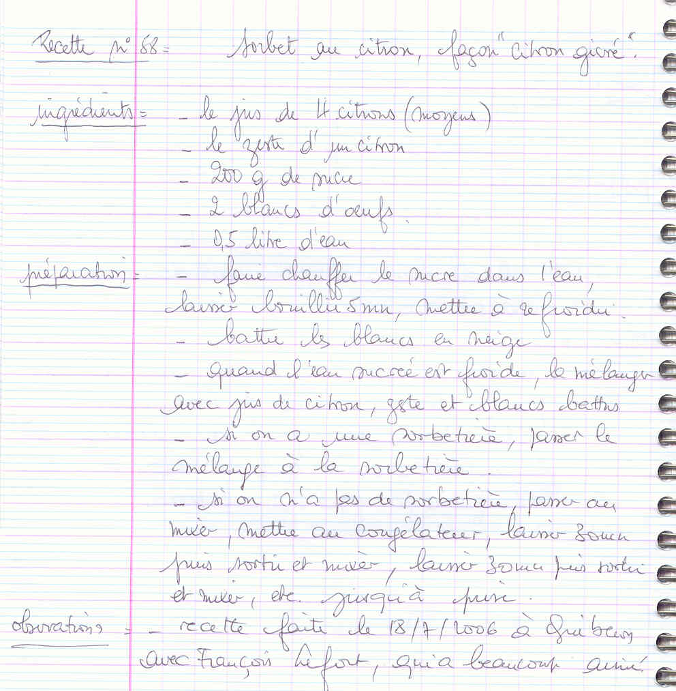

## Ingrédients

- le jus de 4 citrons (moyens)
- le zeste d'un citron
- 200 g de sucre
- 2 blancs d'oeufs
- 0,5 litre d'eau

## Préparation

- faire chauffer le sucre dans l'eau, laisser bouillir 5 mn, mettre à refroidir
- battre les blancs en neige
- quand l'eau sucrée est froide, la mélanger avec jus de citron, zeste et blancs battus
- si on a une sorbetière, passer le mélange à la sorbetière
- si on n'a pas de sorbetière, passer au mixer, mettre au congélateur, laisser 30 mn puis sortir et mixer, laisser 30 mn puis sortir et mixer, etc. jusqu'à prise

## Observations

- recette faite le 18/7/2006 à Quiberon avec François Lefort, qui a beaucoup aimé.
