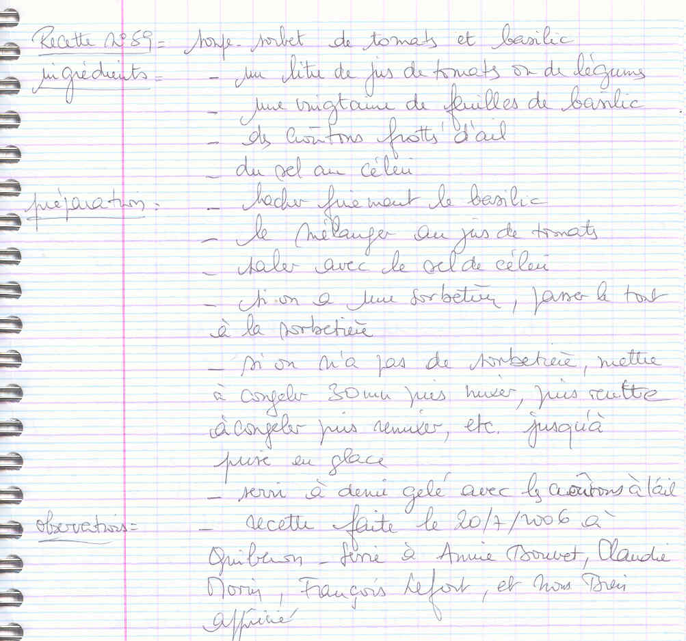

## Ingrédients

- un litre de jus de tomates ou de légumes
- une vingtaine de feuilles de basilic
- des croûtons frottés d'ail
- du sel au céleri

## Préparation

- hacher finement le basilic
- le mélanger au jus de tomates
- saler avec le sel de céleri
- si on a une sorbetière, passer le tout à la sorbetière
- si on n'a pas de sorbetière, mettre à congeler 30 mn puis mixer, puis remettre à congeler puis remixer, etc. jusqu'à prise en glace
- servir à demi gelé avec les croûtons à l'ail

## Observations

- recette faite le 20/7/2006 à Quiberon - servie à Annie Bouvet, Claudie Morin, François Lefort, et nous deux. Appréciée.
