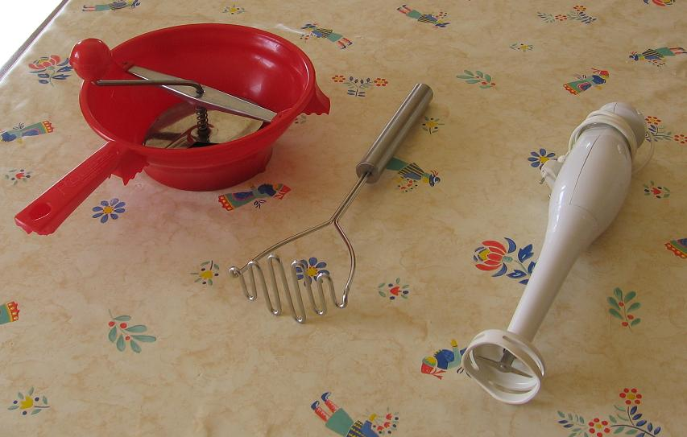

On peut s'interroger sur l'intérêt d'une recette aussi banale qu celle d'une soupe de poireaux et de pommes de terre... Et pourtant, en regardant la question de plus près, on verra qu'on peut raffiner facilement cette recette de base, ne serait-ce qu'en adoptant une de ses quatre variantes plutôt qu'une autre, en mettant du bouillon plutôt que de l'eau, en faisant revenir le poireau, en gardant beaucoup de son vert, en complétant par du fromage, en servant en petites soupières, etc. laissez vous tenter...

## Ingrédients (pour 6 personnes)

- 2 litres de bouillon de poule, de préférence fait maison (cf. observation 1 ci-dessous), ou d'eau à défaut de bouillon mais c'est moins bon
- 12 pommes de terre de taille moyenne
- 6 poireaux moyens entiers (avec leurs feuilles vertes)
- une cuiller à soupe de beurre, ou à défaut de margarine ou d'huile mais c'est moins bon

## Préparation

- préparer les poireaux en en conservant le maximum de feuilles vertes : couper les extrémités abîmées, puis fendre le poireau en deux dans le sens de la longueur, rincer chaque brin obtenu en en enlevant que le strict minimum, puis ciseler en morceaux de 1 cm de long environ
- mettre à revenir les morceaux de poireau dans une sauteuse avec le beurre en remuant sans cesse jusqu'à ce que les poireaux soient devenus transparents sans les laisser brûler (le beurre non plus ne doit surtout pas noircir)
- couvrir les poireaux avec du bouillon et laisser mijoter à feu moyen, en ajoutant du bouillon en cours de cuisson (les poireaux doivent toujours baigner)
- éplucher les pommes de terre et les débiter en lamelles de 2 à 4 mm d'épaisseur, joindre ces lamelles au fur et à mesure au contenu de la sauteuse
- quand toutes les pommes de terre ont été débitées, transvaser le tout de la sauteuse dans une casserole ou une cocotte en adjoignant le reste du bouillon et laisser mijoter à feu moyen jusqu'à ce que les pommes de terre soient cuites (ne pas hésiter à laisser plus longtemps mais à feu doux car, plus cela mijote, meilleur c'est)
- saler et poivrer selan goût mais attention car le bouillon de poule est déjà très salé
- opter en fin de cuisson pour l'une des 4 variantes suivantes (cf. photo ci-dessus), selon que les convives préfèrent la soupe très lisse, légèrement granulée, à peine écrasée, carrément non écrasée :
    - soupe très lisse : passer le tout au mixer électrique à potage
    - soupe légèrement granulée : passer au moulin à manivelle comme pour une purée
    - soupe à peine écrasée : passer au pilon à pommes de terre
    - soupe carrément non écrasée : laisser la soupe telle quelle
- servir la soupe très chaude (attention, s'il y a des enfants, on peut refroidir en les laissant ajouter du lait : cela les amusera), avec à disposition des convives des croûtons, de la crème fraîche, éventuellement des dés de fromage (Vache-qui-rit pour les jeunes, camembert, emmenthal, râpé,etc.)
- le nec plus ultra : servir en petites soupières individuelles avec une branche de persil plat ou de cerfeuil ou de coriandre selon goût

## Observations

1 - on peut bien sûr faire le bouillon à partir de tablettes, mais c'est bien meilleur quand il provient par exemple d'une carcasse de poulet rôti qu'on a mise à mijoter quelques heures dans l'eau et dont on a filtré ensuite le jus
2 - recette exécutée un très grand nombre de fois, toujours appréciée, des petits comme des grands
