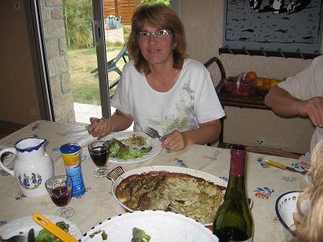
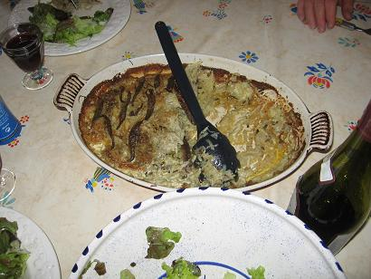
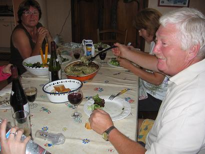
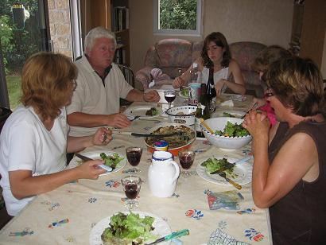

*Pour 6 personnes*

## Ingrédients

- 2 grosses bottes d'oignons blancs frais
- 2 kg de pommes de terre (la variété Charlotte est idéale)
- 150 g de beurre
- 1 beau bouquet de ciboulette (fraîche ou séchée)
- Herbes fraîches pour la décoration (persil plat, coriandre ou cerfeuil)
- 160 à 240 g d'anchois (2 à 3 petits bocaux de 80 g)
- 2 grosses pincées de poivre du moulin
- Pas de sel (celui des anchois suffit amplement)
- 20 cl de crème fraîche

## Préparation

1. Ciseler finement les oignons blancs et la ciboulette.
2. Faire fondre la moitié du beurre dans une grande poêle sans le colorer, avec la ciboulette.
3. Ajouter les oignons ciselés et les faire suer puis fondre doucement sans coloration ni brûlure. Poivrer et réserver le tout.
4. Égoutter les filets d'anchois et les rincer rapidement sous un filet d'eau froide en les séparant délicatement ; les étaler sur une assiette.
5. Préchauffer le four entre 200°C et 220°C (400°F et 425°F).
6. Beurrer généreusement un plat à gratin avec un peu de beurre.
7. À ce stade seulement (pour éviter qu'elles ne noircissent), éplucher les pommes de terre et les râper à la grille moyenne.
8. Dans le plat à gratin, superposer successivement une couche d'oignons fondus, une couche de pommes de terre râpées, un rang d'anchois, puis renouveler avec oignons et pommes de terre en terminant par une couche d'anchois généreusement poivrée.
9. Verser la moitié de la crème fraîche sur l'ensemble et enfourner pour 20 minutes de cuisson.
10. Sortir le plat du four, napper avec le reste de crème et parsemer de noisettes de beurre restantes.
11. Réenfourner et poursuivre la cuisson pendant 30 minutes jusqu'à ce que le gratin soit bien doré et croustillant sur les bords.
12. Décorer d'herbes fraîches et servir immédiatement.

## Observations

- **Contexte :** Recette exécutée le 7 août 2006 à Quiberon pour 6 convives (Denise, Jean-Claude et leurs filles Céline et Fanny, Mamy et moi).
- **Assaisonnement :** Bien apprécié, bien que certains convives aient souhaité une pincée de sel supplémentaire.
- **Accompagnement :** S'accompagne idéalement d'une belle salade verte fatiguée à l'huile d'olive et d'un Côtes-du-Rhône Villages.
- **Conseil :** Les pommes de terre râpées s'oxydent très rapidement ; il est impératif de les râper au tout dernier moment juste avant d'enfourner.

