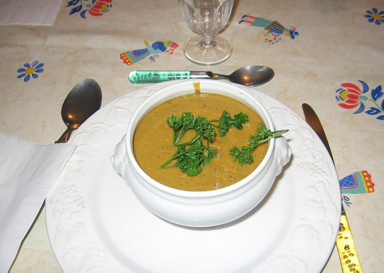
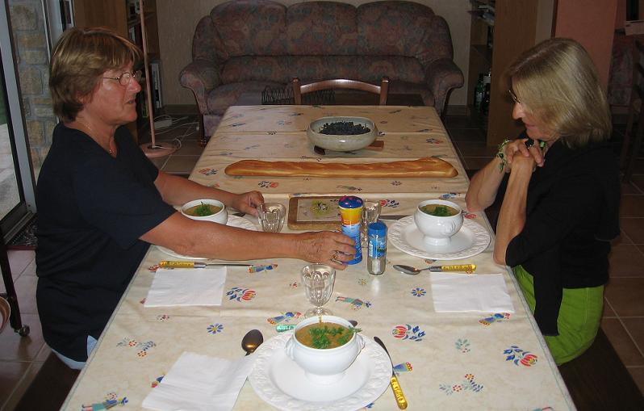
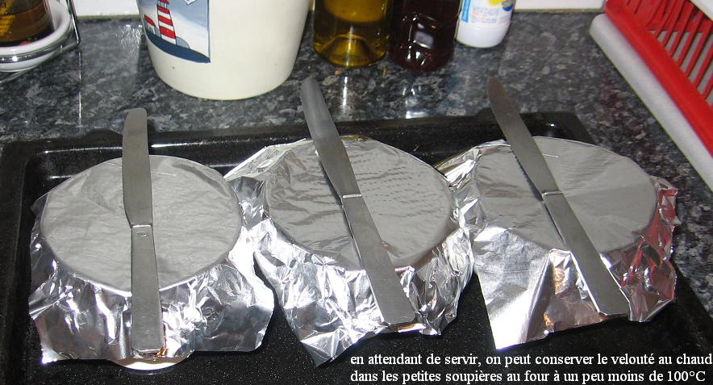

.

## Ingrédients (pour 4 personnes)

- 1,3 kg de moules de bouchot
- une grosse botte d'oseille fraîche
- 2 pommes de terre de taille moyenne
- 4 beaux oignons jaunes
- 150 g de fanes de céleri
- 5 cuillers à soupe de concentré de tomate
- une branche de thym
- 3 feuilles de laurier
- un oeuf
- 3 cuillers à soupe de crème fraîche
- 2 cuiller d'huile d'olive
- 1/2 citron jaune
- sel et poivre, selon goût

## Préparation

- nettoyer les moules en les brossant, en en retirant les "cheveux", en éliminant celles qui ne se ferment pas, réserver
- mettre les deux pommes de terre à cuire dans l'eau, puis les peler et les réserver
- hacher menu le céleri et les oignons, faire revenir dans l'huile d'olive à la sauteuse en évitant de les brûler
- ajouter les moules et le vin, couvrir d'eau, ajouter le citron découpé en rondelles, saler et poivrer, porter à ébullition en remuant jusqu'à ce que les moules soient ouvertes (quelques minutes)
- égoutter les moules en conservant le jus qu'on met à réduire d'un tiers environ
- décoquiller les moules et les réserver
- séparer le blanc et le jaune de l'oeuf
- mélanger le jaune d'oeuf et la crème fraîche, réserver
- battre le blanc presque en neige, y mélanger le concentré de tomate, le thym et le laurier, bien mélanger
- retirer le jus des moules du feu, y mettre le mélange précédent, remettre sur le feu et laisser frémir quelques minutes
- retirer du feu, y mettre l'oseille qu'on a préalablement ciselée, couvrir d'un linge et laisser infuser quinze minutes
- retirer le thym, le laurier et les rondelles de citron
- mélanger au jus le mélange du jaune d'oeuf et de crème, ainsi que les pommes de terre cuites et pelées
- passer le jus au mixer
- mélanger les moules au jus mixé
- servir en petites soupières avec quelques branches de persil, ou de cerfeuil, ou de coriandre

## Observations

1 - recette exécutée le 1er septembre 2006 et testée par Andrée, Mamy et moi.
2 - j'avais laissé trop de citron (la peau du citron ayant été laissée et broyée avec le jus, ce qu'il ne faut pas faire, car le goût de citron est trop fort)
