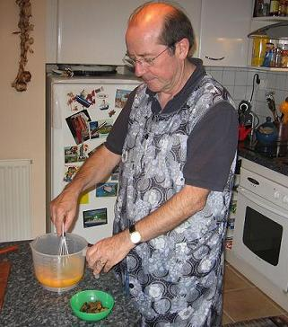
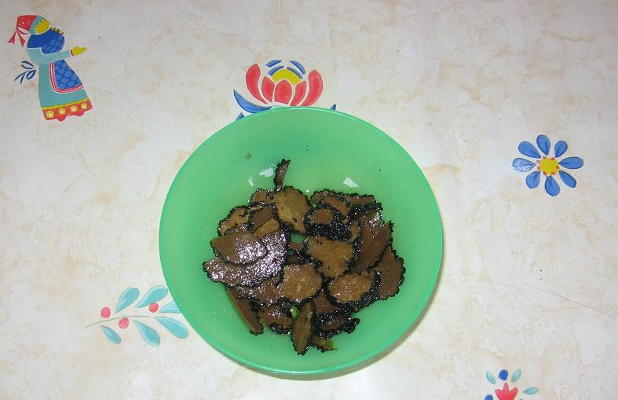
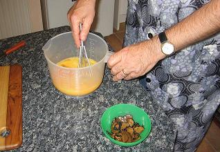
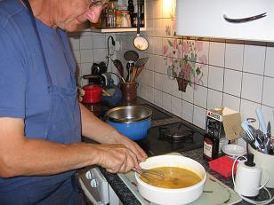
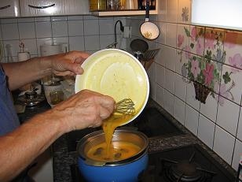
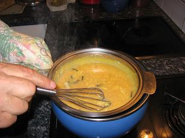

*Pour 4 personnes*

## Ingrédients

- 10 œufs extra-frais
- 50 g de truffes conservées dans l'huile
- 50 g d'huile des truffes
- 1 c. à soupe de madère
- 10 cl de crème fraîche
- Sel et poivre du moulin

## Préparation

1. Casser les œufs dans une terrine ou un cul-de-poule et les battre légèrement au fouet comme pour une omelette.
2. Ajouter l'huile des truffes, une pincée de sel et quelques tours de moulin à poivre, puis battre à nouveau.
3. Égoutter les truffes et les émincer en fines lamelles régulières.
4. Incorporer les lamelles de truffes aux œufs battus. Couvrir et réserver au réfrigérateur pendant au moins 1 heure pour que les arômes infusent intimement.
5. Placer la terrine au bain-marie frémissant sur feu doux, et fouetter sans arrêt avec régularité.
6. Dès que la masse commence à épaissir et prend une consistance crémeuse et onctueuse, couper le feu.
7. Retirer immédiatement la terrine du bain-marie, incorporer la crème fraîche et la cuillère de madère en fouettant doucement hors du feu pour stopper la cuisson.
8. Servir aussitôt dans des assiettes tièdes avec des mouillettes de pain grillé.

## Observations

- **Contexte :** Recette exécutée par Michel et JP le 3 septembre 2006 à Quiberon, après contact téléphonique avec Jean-Marc et Joëlle qui nous avaient très gentiment offert les truffes. Nous étions quatre convives (Andrée, Michel, F. et moi) : l'une des plus grandes délices de la cuisine maison !
- **Menu du festin :** Dégusté entre des huîtres farcies grillées ([recette n° 67](/pjpcode/recipes/0067/recipe.html)) et une tarte au chocolat et aux poires ([recette n° 68](/pjpcode/recipes/0068/recipe.html)). Sans oublier l'apéritif autour d'un Tokaji de 2003 (Hárslevelü) rapporté de Slovaquie par Michel la veille.
- **Variantes :** Le madère n'est pas indispensable mais enrichit le bouquet aromatique. À la place de l'huile des truffes, on peut employer du beurre doux, mais l'huile de macération des truffes décuple le parfum.
- **Accompagnement :** Servi avec un excellent vin rouge du Sud-Ouest, un Côtes-du-Marmandais (Château de Beaulieu) 2002.

