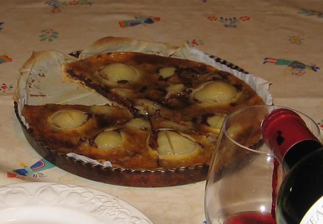

## Ingrédients

pour 8 personnes
La tarte se compose, de bas en haut, de la pâte à tarte, d'une nappe de chocolat, des poires, d'une nappe de crème.
Les ingrédients sont les suivants :
- pour la pâte à tarte et les poires :
    - une pâte feuilletée, ou brisée, du commerce avec son papier sulfurisé
    - une boîte de poires au sirop contenant 6 à 8 demi-poires
- pour faire la nappe de chocolat :
    - une tablette de chocolat noir type Nestlé pour dessert (200G)
    - 100g de beurre ramolli
    - 1/2 verre de lait
- pour faire la nappe de crème :
    - 1 pot de 20 cl de crème fraîche
    - 75 g de sucre en poudre
    - 1 oeuf
    - une poignée de cerneaux de noix ordinaires ou de noix de pécan

## Préparation

- Préchauffer le four à 200°C pendant 15 minutes
- Découper le chocolat en carrés, les  mettre les carrés dans une casserole, ajouter le beurre ramolli et le lait
- Mettre à fondre à deux doux en remuant sans cesse avec une cuiller de bois, en ajoutant du lait si nécessaire, jusqu'à obtenir une pâte lisse ; réserver
- Dans un mixer, mettre le sucre, l'oeuf et la crème ; battre
- Sortir les poires au sirop de la boîte, les étaler sur du papier absorbant pour les égoutter
- Déballer la pâte feuilletée et laosez la pâte avec son paier dans un moule à tarte
- La mettre à four maintenant chaud 3 à 4 minutes pur la durcir un peu (la piquer à la fourchette pour q'elle ne gonfle pas ; si elle gonfle, applatir les bosses)
- Etaler le chocolat fondu dans le fond de la tarte
- Disposez les 6 demi-poires dans le fond de la tarte comme des pétales de fleurs
- Verser la crème entre les poires
- Mettre au four 50 à 55 minutes à 190°C

## Observations

- recette exécutée le 2 septembre 2006 à Quiberon avec Andrée, Michel, F et moi
- très agréable pour les amateurs de chocolat
