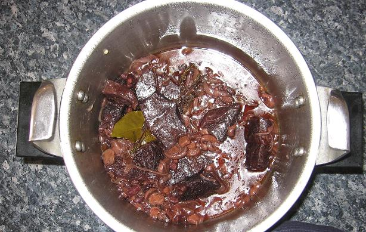

## Ingrédients (pour 4 personnes)

- 800 g de paleron de boeuf (cf. observation n°1)
- 100 g de lardons non fumés (cf. observation n°2)
- 3 cuillers à soupe d'huile ou de margarine
- une bouteille (au moins) de vin rouge très tanique (cf. observation n°3)
- 2 gros oignons jaunes
- une gousse d'ail, d'Arleux de préférence
- une cuiller à soupe de farine
- un bouquet garni
- sel, poivre, selon goût
- une petite boîte de champignons de Paris, en tranches
- un petit bouquet de persil
- deux belles carottes

## Préparation

- dans une cocotte-minute non fermée, faire revenir la viande coupée en gros dés avec les lardons, dans l'huile ou la margarine
- ajouter les oignons débités en rondelles de 1 à 3 mm d'épaisseur
- saupoudrer de farine, remuer, laisser dorer deux ou trois minutes
- verser le vin rouge de sorte que la viande soit totalement couverte
- mettre les carottes débités en rondelles de 1 mm d'épaisseur
- mettre le bouquet garni, et l'ail coupé en quatre
- fermer la cocotte-minutes et laisser mijoter une heure à partir du moment où la soupape tourne
- en fin de cuisson, dresser dans un plat avec les champignons égouttés et le persil saupoudré
- mettre les champignons égouttés

## Observations

1 - la viande pour boeuf bourguignon est classiquement de la veine grasse ou du premier talon, mais il s'agit alors d'une viande très grasse, ce qui a des avantages (c'est plus goûteux, cela fond et nécessite donc moins de vin) mais aussi des inconvénients (c'est beaucoup plus calorique et d'une texture moins agréable à manger, à cause du gras).
2 - à défaut de lardons, on peut utiliser du lard de poitrine non fumé, qu'on coupe en dés (on fait des lardons !)
3 -contrairement à ce qu'on pourrait penser, ce n'est pas avec du vin de Bourgogne qu'on fait aujourd'hui le meilleur boeuf bourguignon... La raison de ce paradoxe est que le vin de Bourgogne a évolué est est devenu beaucoup moins tanique qu'il pouvait l'être il y a 50 ou 100 ans ; on prendra donc un vin du Sud, comme un Sidi Brahim, un Madiran, un Côtes du Marmandais ou un Cahors
4 - recette exécutée le 30 août 2006 à Quiberon pour 2 convives (F et JP) et deux repas ; mais faite de très nombreuses fois auparavant
5- bien appréciée, avec des pommes de terre sautées (peut de faire aussi avec des pâtes)
