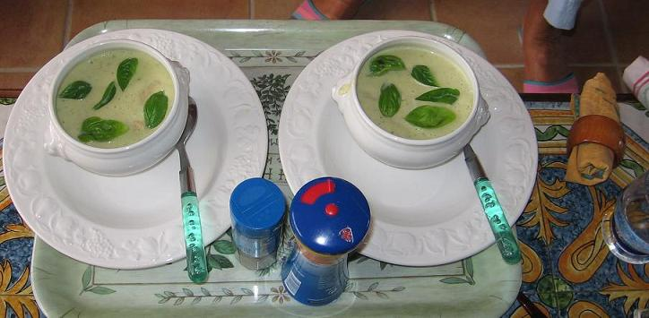

## Ingrédients (pour 4 personnes)

- 1 kg d'asperges cuites en bocal (les blanches sont beaucoup moins chères)
- 10 cl (ou 100 g) de fromage blanc, de type faisselle de préférence 0%
- une botte de basilic frais
- 1 litre de bouillon de poule
- 3 cuillers à soupe d'huile, ou de margarine
- sel, poivre, selon goût

## Préparation

- égoutter les asperges et en réserver les pointes pour la texture
- enlever les feuilles de basilic, en réserver quelques-unes pour la décoration
- peler et débiter les oignons, les faire revenir dans l'huile sans les faire brûler
- couper les asperges en tronçons de 1 cm, les ajouter aux oignons, faire revenir 5 mn en remuant
- mettre le bouillon de poule chaud, couvrir et laisser mijoter 15 mn
- passer au mixer ou au moulin à légumes suivant qu'on aime une texture lisse ou granuleuse
- ajouter la faisselle et bien mélanger, saler et poivrer selon goût
- hacher les feuilles de basilic non réservées et mélanger
- mettre les pointes d'asperges dans des petites soupières individuelles, couvrir de la soupe, mettre les feuilles de basilic réservées en décoration et servir sans attendre

## Observations

1 - recette exécutée le 4 septembre 2006 à Quiberon pour 2 convives (F et JP) : nous avons mangé les 4 parts à deux...
2- donc, bien appréciée
