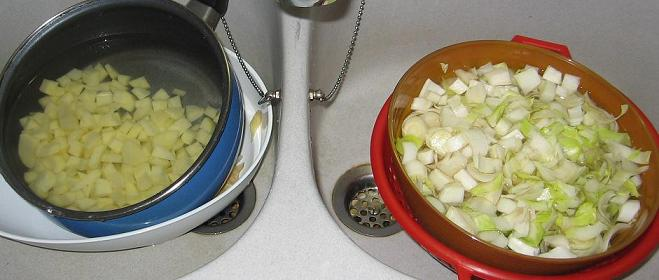

*Pour 4 personnes*

## Ingrédients

- 600 g d'endives bien fraîches
- 400 g de pommes de terre
- 1 c. à soupe d'huile d'olive ou de beurre
- 2 c. à soupe de jus de citron
- 75 cl de bouillon de volaille chaud
- 100 g de fromage blanc à 0% (à température ambiante)
- 4 brins de cerfeuil, ciboulette ou persil plat
- Sel fin et poivre du moulin

## Préparation

1. Porter le bouillon de volaille à frémissement. Sortir le fromage blanc du réfrigérateur à l'avance pour qu'il soit à température ambiante.
2. Parer les endives, ôter le cône amer de la base et les émincer très finement. Peler et tailler les pommes de terre en petits dés.
3. Dans une sauteuse, chauffer l'huile d'olive et faire suer les endives émincées pendant 3 minutes avec le jus de citron.
4. Verser le bouillon chaud et les dés de pommes de terre. Poivrer (le bouillon salant généralement suffisamment).
5. Porter à ébullition, couvrir et laisser cuire à feu moyen pendant 30 minutes jusqu'à tendreté des légumes.
6. Prélever la moitié du potage, la mixer très finement au mixeur plongeant, puis la reverser dans la sauteuse pour combiner une texture veloutée et des morceaux fondants.
7. Incorporer le fromage blanc hors du feu en fouettant vivement pour lier le potage.
8. Réchauffer quelques instants sur feu très doux sans faire bouillir (pour préserver le fromage blanc).
9. Verser dans de petites soupières individuelles, parsemer de pluches de cerfeuil frais et servir aussitôt.

## Observations

- **Contexte :** Recette exécutée le 6 septembre 2006 à Quiberon pour 2 convives (F. et JP).
- **Légèreté :** Très appréciée ; sa composition diététique et saine (à peine 25 kcal par personne) passe totalement inaperçue grâce à son onctuosité.
