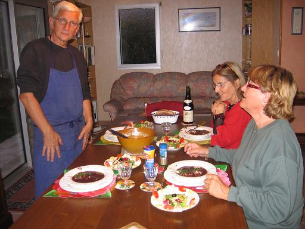

*Pour 4 personnes*

## Ingrédients

- 8 œufs fermiers extra-frais
- 120 g de poitrine demi-sel (ou lardons)
- 100 g de beurre
- 1 c. à soupe d'huile
- 4 carottes
- 4 oignons jaunes
- 2 échalotes
- 1 bouteille de vin rouge tannique et charpenté
- 20 cl de vinaigre d'alcool blanc
- 1 c. à soupe de ciboulette fraîche ciselée
- Sel et poivre du moulin

## Préparation

1. **Compote d'oignons :** Éplucher et émincer finement les 4 oignons. Dans une casserole, les faire fondre doucement au beurre pendant 20 à 25 minutes jusqu'à ce qu'ils soient bien compotés et fondants sans coloration. Réserver au chaud au four à basse température (100°C / 212°F) sous une feuille d'aluminium.
2. **Réduction de vin rouge :** Verser la bouteille de vin rouge dans une casserole et porter à ébullition. Dès les premiers bouillons, retirer du feu et flamber pour brûler l'alcool. Remettre sur feu doux et faire réduire de moitié.
3. **Miroir au vin rouge :** Hacher finement les 2 échalotes, les ajouter au vin rouge réduit et poursuivre la réduction jusqu'à consistance sirupeuse.
4. **Purée de carottes :** Peler et couper les carottes en rondelles, puis les cuire à l'eau bouillante salée pendant 30 minutes. Égoutter et mixer en purée très fine.
5. **Liaison de la sauce :** Incorporer la réduction sirupeuse de vin rouge dans la purée de carottes. Fouetter vigoureusement sur feu doux en incorporant 50 g de beurre bien froid en dés pour monter la sauce. Goûter et rectifier l'assaisonnement.
6. **Lardons dorés :** Couper la poitrine en lardons réguliers. Les faire dorer à sec à la poêle pendant 5 minutes, puis les égoutter sur du papier absorbant.
7. **Pochage des œufs :** Dans une grande casserole, faire frémir 2 litres d'eau non salée avec les 20 cl de vinaigre blanc. Casser chaque œuf dans une tasse. Créer un tourbillon dans l'eau frémissante et y faire glisser les œufs 2 par 2. Pocher pendant 3 minutes chrono à frémissement doux. Sortir délicatement les œufs à l'écumoire et les égoutter sur un linge propre.
8. **Dressage et service :** Dans chaque assiette creuse chaude, étaler un lit de compote d'oignons fondants, déposer 2 œufs pochés encore fumants, entourer de lardons croustillants et napper de sauce au vin rouge. Parsemer de ciboulette ciselée et servir immédiatement.

## Observations

- **Fraîcheur des œufs :** Plus les œufs sont extra-frais, plus le blanc est serré autour du jaune et mieux le pochage s'effectue sans s'effilocher.
- **Contexte :** Recette exécutée le 9 septembre 2006 à Quiberon pour Mamy et moi, puis refaite le 17 septembre pour 4 convives avec Michel et Andrée Pioger.
- **Accords vins :** Le vin de confection était un Côtes-du-Marmandais très réussi ; le vin servi à table pour le repas était un superbe Irancy 2002 de chez Annick Navarre.
