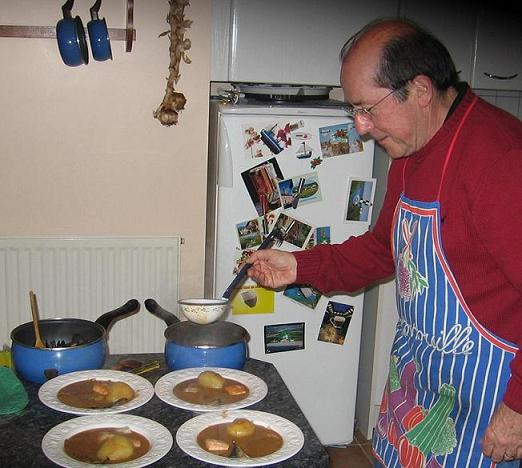
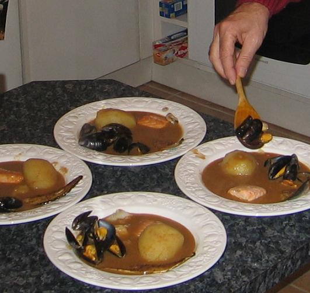

Ingrédients :  (pour 4 personnes)
- une boîte de soupe de poisson de la Belle-Isloise, des Jeannettes ou de la Quiberonnaise de 800 g environ
- une boîte de cotriade de la Belle-Isloise, des Jeannettes ou de la Quiberonnaise de 800 g environ
- 200 g à 300 g de filet de saumon
- 200 g à 200 g de filet de cabillaud
- 200 g à 300 g d'un poisson fumé comme le haddock, le hareng ou le maquereau
- 400 g de moules fraîches
- 4 tartines de pain
- 2 grosses gousses d'ail d' Arleux
- 2 cuillers à café d'huile d'olive
- 4 grosses pommes de terre
- deux tablettes de court-bouillon
- sel, poivre selon goût

## Préparation

- préchauffer le four à 100C
- y mettre les qssiettes creuses de façon qu'elles soient chaudes quand on servira la bouillabaisse
- mettre la soupe en boîtes à chauffer doucement, car elle ne doit absolument pas bouillir
- mettre un litre d'eau à bouillir, y dissoudre les tablettes de court-bouillon
- faire griller les tartines et les frotter avec les gousses d'ail
- peler les pommes de terre et les mettre à cuire doucement dans le court-bouillon
- les y laisser quand elles sont cuites

- couper chaque poisson en 4 parts
- dans une poêle, mettre à revenir  les poissons dans l'huile d'olive, en prenant bien garde à ne pas les déliter
- réserver les parts de poisson au four dans du papier d'aluminium
- laver les moules, les nettoyer en leur enlevant les cheveux
- les mettre dans une grande casserole couverte à feu moyen et les secouer de façon qu'elles soient bien ouvertes
- sortir les assiettes du four, y déposer les parts de poisson, les pommes de terre
- couvrir de soupe, partager les moules entre les assiettes
- servir le tout aussitôt accompagné des tartines aillées.

## Observations

1 - recette exécutée le 15 septembre 2006 à Quiberon pour Michel Pioger, Andrée Pioger et nous deux
2 - très bon saupoudré d'un peu de gruyère râpé, avec un bon Muscadet sur lie.
