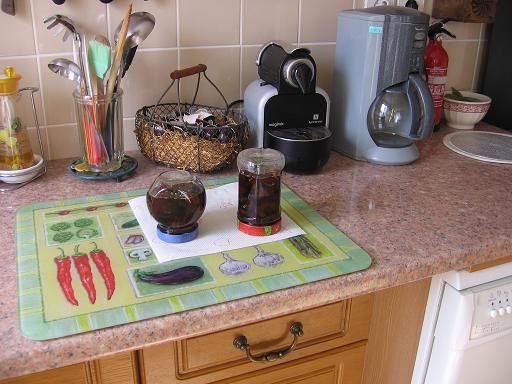

## Ingrédients (pour 2 pots moyens)

- 500g de figues équeutées
- 500 g de sucre
- le jus d'un citron
- une cuiller à café d'extrait de vanille
- 2 pots à bouchon vissant

## Préparation

- faire un sirop avec eau, sucre, vanille et citron
- quand le sirop est au boulé, y mettre les figues et faire cuire 5 mn
- retirer les figues et laisser cuire doucement le sirop seul 10 mn
- remettre les figues et laisser cuire à feu doux 30 mn
- pendant la cuisson, ébouillanter les pots et leurs couvercles
- en fin de cuisson, égoutter les pots, y mettre les figues à l'écumoire puis compléter avec le sirop
- visser les couvercles à fond et retourner les pots, les laisser refroidir avant de les retourner à l'endroit.

## Observations

- confitures faites à Rennes le 28 septembre 2006 avec les premières figues (500g) récoltées à Quiberon
