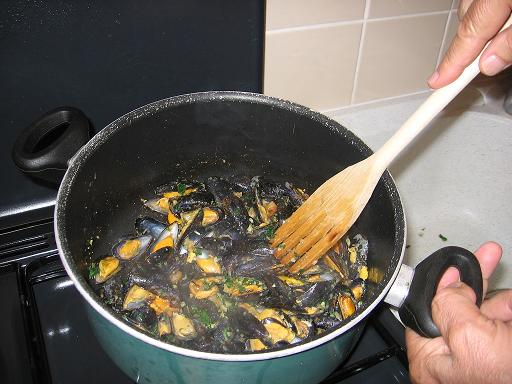

*Pour 4 personnes*

## Ingrédients

- 2 kg (ou 2 litres) de moules fraîches de bouchot
- 1 verre de vin blanc sec
- 100 g de beurre demi-sel
- 4 gousses d'ail d'Arleux
- 1 bouquet de persil plat
- 4 biscottes écrasées (ou pain sec émietté)
- 2 feuilles de laurier, 1 branche de thym
- Sel fin et poivre du moulin

## Préparation

1. Hacher finement les gousses d'ail et le persil plat.
2. Écraser les biscottes au mortier ou au rouleau à pâtisserie en chapelure fine.
3. Nettoyer et ébarber les moules sous l'eau froide, en éliminant celles qui restent ouvertes.
4. Dans une grande casserole, faire chauffer le vin blanc avec le thym et le laurier.
5. Y jeter les moules sur feu vif, couvrir et secouer la casserole 3 à 4 minutes jusqu'à ce qu'elles s'ouvrent à peine.
6. Égoutter les moules et retirer une valve sur chaque coquille (la coquille vide supérieure) en conservant la valve contenant la moule.
7. Faire fondre le beurre demi-sel dans une grande poêle sans le laisser colorer.
8. Déposer les demi-coquilles de moules dans la poêle et remuer délicatement pour bien les imprégner de beurre fondu.
9. Saupoudrer la persillade et la chapelure de biscottes sur les moules. Remuer en continuant la cuisson sur feu doux jusqu'à ce que tout le jus et le beurre soient absorbés par la panure.
10. Poivrer au moulin (saler très modérément) et servir immédiatement bien chaud.

## Observations

- **Contexte :** Recette exécutée le 5 octobre 2006 pour Mamy et moi.
- **Accord :** Absolument succulent accompagné d'un bon Muscadet sur lie bien frais.
