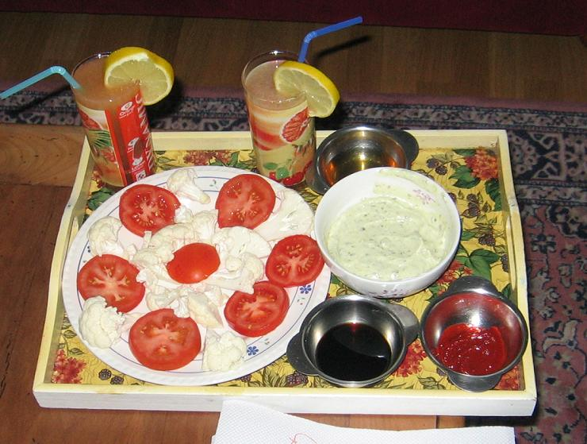

## Ingrédients (pour 8 personnes)

- 4 tomates crues plutôt fermes
- un demi-chou-fleur cru
- 4 endives crues plutôt grosses
- 2 betteraves cuites
- 500 g de fromage blanc 0%
- 4 cuillers à soupe de sauce au pistou pour pâtes (cf. observation n°2)
- 4 gousses d'ail

- 2 échalottes
- 1 cuiller à café de cumin
- 1 cuiller à café de piment de Cayenne
- 1 cuiller à café de curry
- 4 cuillers à soupe de sauce impériale (pour nems)
- 4 cuillers à soupe de sauce de soja
- 4 cuillers à soupe de de sagarroia (chutney basque)
- sel et poivre selon goût

## Préparation

- couper les tomates et les betteraves en rondelles épaisses
- défaire les endives feulle à feuille, éventuellement couper les feuilles en deux dans le sens de la longueur si elles sont très larges
- détailler le chou-fleur en fleurettes
- broyer ail et échalotes ensemble
- sur de grandes assiettes plates ou sur des plats ronds, disposer les légumes forme de fleurs avec les coeurs des fleurs faits des tranches de tomates ou des tranches de betteraves, et les pétales faits des endives en intercalant les fleurettes de choux-fleurs ; toute autre disposition est possible du moment qu'on obtient un effet agréble à l'oeil (cf. photos)
- pour les sauces, prévoir 4 bols et 3 tasses si on veut 6 sauces différentes (cf. observation n°1) et les attribuer comme suit :
    - tasse n°1 : la sauce impériale
    - tasse n°2 : la sauce de soja
    - tasse n°3 : la sagarroia
    - bol n°1 : le quart du fromage blanc mélangé à la sauce au pistou
    - bol n°2 : le quart du fromage blanc mélangé au curry et salé/poivré selon goût
    - bol n°3 : le quart du fromage blanc mélangé au cumin
    - bol n°4 : le quart du fromage blanc mélangé à l'ail et à l'échalote, puis salé/poivré selon goût

## Observations

1 - la recette est ici présentée avec tous les ingrédients mais on peut n'en utiliser que deux ou trois, tant en ce qui concerne les légumes qu'en ce qui concerne les sauces où ces légumes seront trempés.
2 - cette sauce se trouve toute faite au rayon sauces des super-marchés ; on peut aussi facilement la faire en écrasant 4 gousses d'ail dans 4 cuillers à soupe d(huile d'olive et en ajoutant une douzaine de feuilles de basilic ciselées.
3 - recette exécutée tout au long de l'été et de l'automne 2006, particulièrement en accompagnement d'appéritifs non alcoolisés ; recette toujours appréciée.
