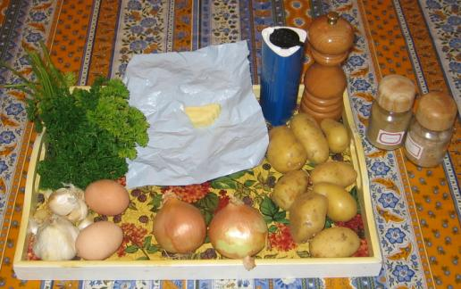
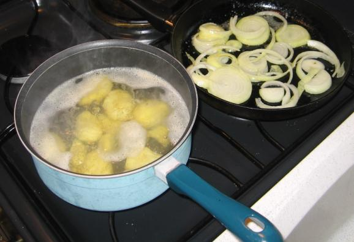
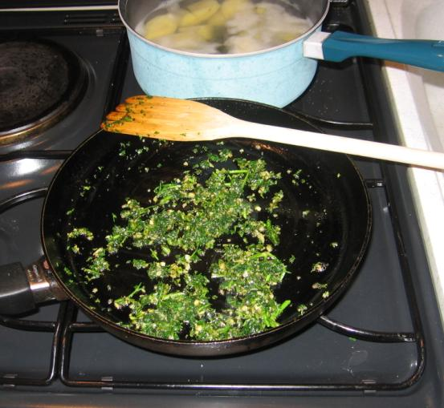
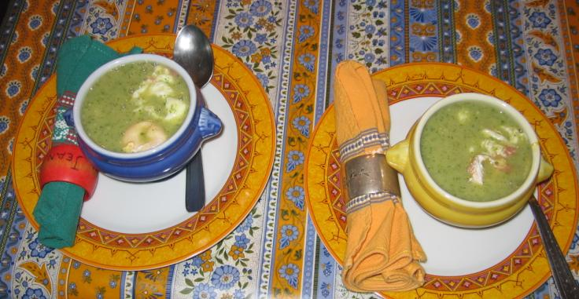

Mon ami Kurt de Dresde, à qui on vient de fêter ses 96 ans le 21 septembre,
m'a livré le secret d'une de ses soupes préférées, la soupe à l'ail et aux
pommes de terre&nbsp;; j'ai essayé de la faire en remplaçant certains
ingrédients que je n'avais pas sous la main par d'autres. Cette soupe est
excellente (un extrait du mail de Kurt est donné en observation n°5).

## Ingrédients (pour 4 personnes)

- 8 grosses pommes de terre
- 8 gousses d'ail
- 2 litres d'eau
- un gros bouquet de persil
- 2 gros oignons jaunes
- une cuiller à soupe de beurre ou de margarine
- 100 g de lard pas trop gras (cf. observation n°2)
- une pincée de marjolaine (cf. observation n°3)
- une pincée de livêche, encore appelé ache des montagnes ou céleri
  perpétuel (cf. observation n°4)
- sel et poivre selon goût

## Préparation

- mettre l'eau dans une casserole sans la mettre à chauffer tant que les
  pommes de terre n'y sont pas (sinon cela fait de la colle)
- éplucher les pommes de terre, les débiter en rondelles et les jeter dans
  l'eau froide au fur et à mesure
- mettre l'eau et les pommes de terre à chauffer à feu vif
- hacher ail et persil et réserver
- hacher les oignons grossièrement et réserver

- faire revenir les oignons à la poêle dans un peu de beurre sans les
  brûler et réserver
- faire revenir très peu de temps (30 secondes par exemple) ail et persil
  dans un peu de beurre à la poêle, puis mélanger aux oignons et réserver
- faire revenir le lard sans beurre s'il a assez de gras, puis réserver

- quand les pommes de terre sont cuites, passer au mixer électrique dans
  l'eau de cuisson, puis saler et poivrer selon goût
- ajouter à la soupe la marjolaine et la livêche et remuer à la cuiller
- ajouter à la soupe ce qu'on a réservé après friture (ail, persil,
  oignons, lard), puis passer le tout une dernière fois au mixer
- servir immédiatement en petites soupières ou garder au chaud au four
  à 100°C

## Observations

1. Recette exécutée le 9 octobre 2006 à Rennes pour F et moi&nbsp;;
   absolument délicieux malgré quelques complications inutiles de ma
   part (cf. observation n°2 ci-après).
2. N'ayant pas de lard sous la main, j'ai cru bien faire en remplaçant
   cette protéine animale par une autre&nbsp;: des œufs entiers pochés
   dans l'eau puis mis dans la soupe&nbsp;; c'est très bon mais aussi
   très compliqué comme tous les œufs pochés, et on ne retrouve de toute
   façon pas le bon goût du lard grillé&nbsp;; donc je recommande de
   s'en tenir à la recette de Kurt.
3. N'ayant pas de marjolaine sous la main, j'ai mis une pincée de
   cumin&nbsp;; c'est bon aussi, mais la prochaine fois j'essaierai de
   trouver de la marjolaine.
4. La livêche (en allemand «&nbsp;*Liebstock-kraut*&nbsp;») semble
   d'utilisation très courante dans la cuisine en Allemagne. En latin&nbsp;:
   *levisticum officinale* — d'où «&nbsp;livêche&nbsp;», «&nbsp;ache des
   montagnes&nbsp;» ou «&nbsp;céleri perpétuel&nbsp;».
