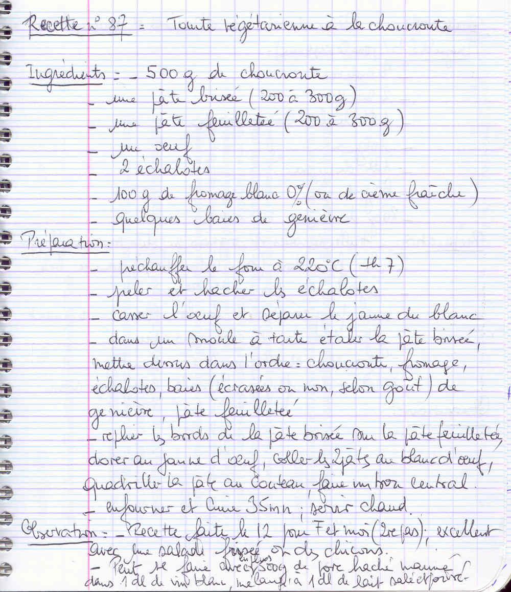

## Ingrédients

- 500 g de choucroute
- une pâte brisée (200 à 300 g)
- une pâte feuilletée (200 à 300 g)
- un oeuf
- 2 échalotes
- 100 g de fromage blanc 0% (ou de crème fraîche)
- quelques baies de genièvre

## Préparation

- préchauffer le four à 220°C (th 7)
- peler et hacher les échalotes
- casser l'oeuf et séparer le jaune du blanc
- dans un moule à tarte étaler la pâte brisée, mettre dessus dans l'ordre : choucroute, fromage, échalotes, baies (écrasées ou non, selon goût) de genièvre, pâte feuilletée
- replier les bords de la pâte brisée sur la pâte feuilletée, dorer au jaune d'oeuf, coller les 2 pâtes au blanc d'oeuf, quadriller la pâte au couteau, faire un trou central
- enfourner et cuire 35 mn ; servir chaud

## Observations

- Recette faite le 12 pour F et moi (2 repas) ; excellent avec une salade frisée ou des chicons.
- Peut se faire avec en plus 500 g de porc haché mariné dans 1 dl de vin blanc mélangé à 1 dl de lait salé et poivré.
