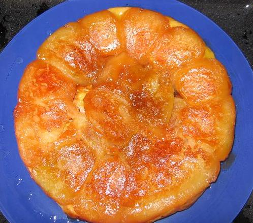

## Ingrédients (pour 8 personnes)

- un moule spécial pour Tatin (24 cm de diamètre, bords hauts)
- 150 g de beurre de très bonne qualité (le goût de la tarte en dépend beaucoup)
- 125 g de sucre
- 1 kg de pommes plutôt fermes (de type granit par exemple)
- une pâte feuilletée (ou brisée, selon goût)

## Préparation

- beurrer le moule avec tout le beurre
- parsemer ce beurre de tout le sucre
- mettre le four à préchauffer à 180C/200C
- éplucher les pommes
- couper ces pommes en quartiers, déposer ces quartiers sur la partie bombée côte à côte, remplir les intervalles de grosses tranches
- mettre sur la gazinière à feu doux de 10 à 15 minutes en surveillant de façon à constater que la caramélisation commence
- enfourner et laisser cuire 15 minutes
- sortir du four et déposer un fond de pâte feuilletée ou brisée un peu plus grand que le diamètre du  moule
- remettre au four 15 minutes
- sortir du four et laisser reposer quelques minutes
- poser un plat de service sur le moule, bien saisir l'ensemble moule et plat avec des chiffons (pour ne pas se brûler) et retourner vivement
- servir aussitôt, de préférence nature (les gourmand\[e\]s accompagnent d'une glace à la vanille, mais c'est un pêché car les soeurs Tatin ne l'ont jamais fait)

## Observations

1 - cette recette est celle que préfèrent les Lichonneux, les gardiens du secret de la vraie tarte Tatin des soeurs Tatin de La-Motte-Beuvron, la recette détenue par le Grand Maître du Secret
2 - en cas de fabrication antérieure, on peut réchauffer à feu doux dix minutes avant de servir, mais ne jamais passer au four à micro-ondes
