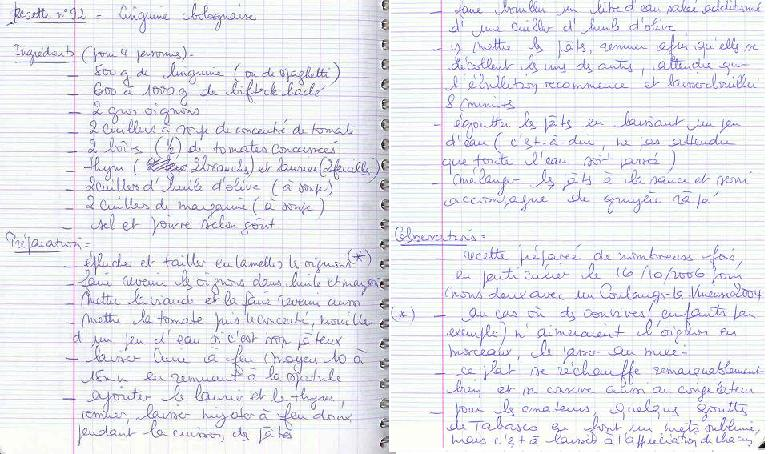

## Ingrédients (pour 4 personnes)

- 500 g de linguine (ou de spaghetti)
- 600 à 1000 g de bifteck haché
- 2 gros oignons
- 2 cuillers à soupe de concentré de tomate
- 2 boîtes (1/2) de tomates concassées
- thym (2 brindilles) et laurier (2 feuilles)
- 2 cuillers à soupe d'huile d'olive
- 2 cuillers à soupe de margarine
- sel et poivre selon goût

## Préparation

- éplucher et tailler en lamelles les oignons (*)
- faire revenir les oignons dans l'huile et la margarine
- mettre la viande et la faire revenir aussi
- mettre la tomate puis le concentré, mouiller d'un peu d'eau si c'est trop pâteux
- laisser cuire à feu moyen 10 à 15 mn en remuant à la spatule
- ajouter le laurier et le thym, remuer, laisser mijoter à feu doux pendant la cuisson des pâtes
- faire bouillir un litre d'eau salée additionné d'une cuiller d'huile d'olive
- y mettre les pâtes, remuer afin qu'elles se décollent les unes des autres, attendre que l'ébullition recommence et bien ébouillanter 8 minutes
- égoutter les pâtes en laissant un peu d'eau (c'est-à-dire, ne pas attendre que toute l'eau soit partie)
- mélanger les pâtes à la sauce et servir accompagné de gruyère râpé

## Observations

- recette préparée de nombreuses fois, en particulier le 16/10/2006 pour nous deux avec un Coulanges-la-Vineuse 2004.
- (*) au cas où des convives (enfants par exemple) n'aimeraient l'oignon en morceaux, le passer au mixer.
- ce plat se réchauffe remarquablement bien et se conserve aussi au congélateur.
- pour les amateurs, quelques gouttes de Tabasco en font un mets sublime, mais c'est à laisser à l'appréciation de chacun.
