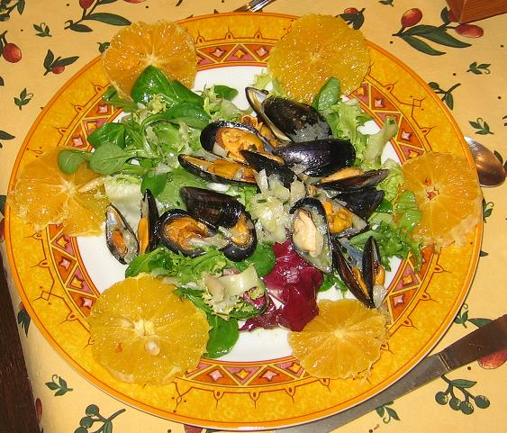

## Ingrédients (pour 4 personnes)

- 2 kg de moules fraîches
- 2 gros oignons
- 2 citrons
- 4 cuillers à soupe d'huille d'olive
- 4 cuillers à soupe de ciboulette ciselée
- 4 oranges
- 400 g de salade de type mesclun, ou roquette, ou frisée
- sel et poivre selon goût

## Préparation

- éplucher les oranges, les peler à vif, les couper en tranches perpendiculaires à leur axe
- éplucher l'oignon et le hacher
- presser le citron et préparer la sauce avec jus de citron, huile d'olive, oignon émincé, ciboulette ciselée, sel et poivre
- laver et gratter les moules, les faire cuire à feu vif dans une casserole en remuant de façon continue
- quand elles sont ouvertes, ne pas attendre, les retirer du feu et jeter une des deux coquilles de chaque moule (celle qui n'adhère pas à la chair)
- arroser les moules encore  chaudes avec la moitié de la sauce, remuer
- mélanger l'autre moitié de la sauce avec la salade
- sur les assiettes individuelles, disposer les moules au centre et la salade autour, servir aussitôt

## Observations

- recette préparée le 20 octobre 2006 à Rennes comme dîner pour F et moi ; excellente !
- si on veut en faire une simple entrée et non un plat principal, diviser toutes les quantités par deux.
