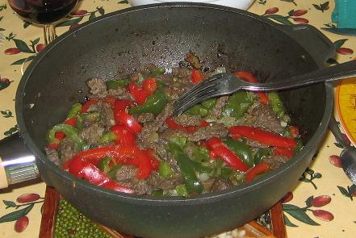

## Ingrédients

Pour 4 personnes :

- 200 g de poivron vert
- 200 g de poivron rouge
- 200 g d'oignon
- 4 cuillers à soupe d'huille d'olive
- 1 bouquet de coriandre ou de ciboulette selon goût
- 500 g de boeuf tendre (filet par exemple)
- 400 g de riz parfumé ou basmati
- 4 cuillers à soupe d'huile de sésame
- une pincée de curry
- sel et poivre selon goût

## Préparation

- laver, épépiner et découper en lanières les poivrons
- éplucher l'oignon et l'ail, et le hacher
- hacher la coriandre ou la ciboulette, selon goût
- mettre le riz à cuire dans 2 litres d'eau bouillante salée et additionnée du curry
- découper le boeuf en fines lamelles, saler et poivrer
- dans une sauteuse ou un wok, faire revenir le boeuf à feu vif dans l'huile pendant 2 minuetes en reemuant sans cesse
- ajouter poivrons, ail et oignon, et faire cuire encore 10 minutes en remuant souvent
- servir chaud avec le riz égoutté

## Observations

- recette préparée le 22 octobre 2006 à Rennes comme dîner pour F et moi ; excellente !
