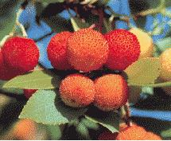
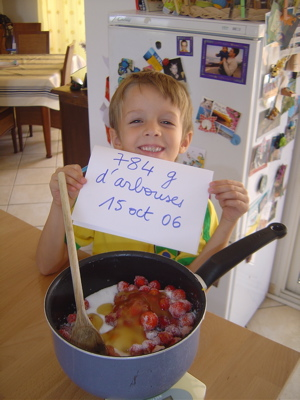

**Recette n°97** : gelée d’arbouses du lac de Tolla

  

**Ingrédients :** (pour 3 pots de gelée)
- 2 kg d’arbouses bien mûres
- 1 kg de sucre

## Préparation

**-         faire chauffer les arbouses dans une casseroles en remuant pour qu’elles se « dissolvent » en une pâte liquide
-         filtrer cette pâte à travers une passoire à mailles fines en pressant avec le dos d’une louche afin d’extraire le maximum de jus
-         mélanger ce jus au sucre (la proportion sucre/jus peut varier de 50% à 1000% selon goût)
-         faire cuire doucement ce mélange jusqu’à obtention d’un sirop encore assez liquid
-         mettre en pots avec bouchons vissés et retourner pour stériliser l’air confiné, le temps du refroidisssement**

## Observations

- recette exécutée le 26 octobre 2006 à Porticcio avec des arbouses cueillies au lac de Tolla alors que nous étions à Porticcio chez Marie-hélène et Frédéric pour les vacances de Toussaint

- cette gelée, de couleur orangée, rappelle le coing et l’abricot ; elle es excellente en tartine ou sur de tartes (cf. recette n° 98)
