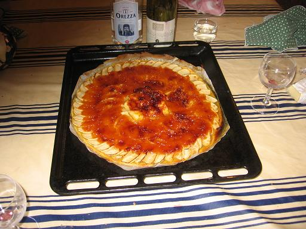

*Pour 4 personnes*

## Ingrédients

- 4 grosses pommes plutôt tendres
- 4 c. à soupe de gelée d'arbouses
- 4 c. à soupe de sucre en poudre
- 1 verre d'eau
- 1 rouleau de pâte brisée

## Préparation

1. Préchauffer le four à 220°C (425°F).
2. Dérouler la pâte brisée sur la plaque du four en conservant son papier sulfurisé.
3. Piquer régulièrement le fond de pâte à la fourchette pour éviter qu'il ne gonfle à la cuisson.
4. Dans une petite casserole, délayer la gelée d'arbouses dans l'eau à feu doux pour obtenir un sirop fluide, puis réserver.
5. Éplucher les pommes, retirer les cœurs et pépins.
6. Couper les pommes en deux et les plonger au fur et à mesure dans une bassine d'eau froide citronnée pour éviter l'oxydation.
7. Émincer chaque demi-pomme en fines lamelles d'environ 5 mm d'épaisseur.
8. Disposer harmonieusement les lamelles de pommes en rosace ou cercles concentriques sur le fond de pâte, en alternant le sens de recouvrement à chaque cercle.
9. Napper généreusement avec le sirop de gelée d'arbouses et saupoudrer un voile de sucre en poudre sur les zones non couvertes.
10. Enfourner et faire cuire à 220°C (425°F) pendant 20 à 25 minutes jusqu'à ce que les bords soient bien dorés. Servir tiède.

## Observations

- **Contexte :** Recette préparée le 28 octobre 2006 à Porticcio ; excellente association entre l'acidulé des pommes et la douceur parfumée de la gelée d'arbouse !
