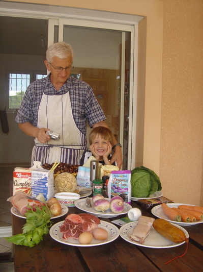
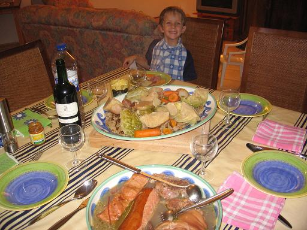
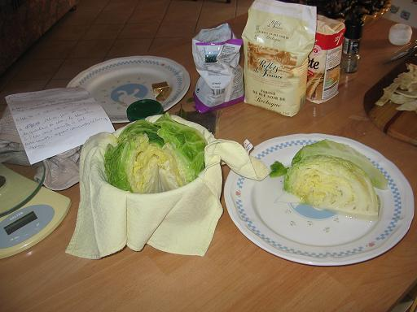

**Recette n° 100** :   Kig ha fars corse

Marie-Hélène et Frédéric, qui avaient la gentillesse de nous héberger à Porticcio fin octobre 2006 avaient envie d'un kig ha fars ; comme nous étions en Corse, nous avons tenté de corsifier en partie cette recette bretonne. Grâce à l'aide du jeune marmiton Max, très doué en cuisine et en cochons sauvages, le résultat fut excellent :

<table style="width: 100%; text-align: left;" data-border="0" data-cellpadding="2" data-cellspacing="2">
<colgroup>
<col style="width: 50%" />
<col style="width: 50%" />
</colgroup>
<tbody>
<tr class="odd">
<td style="vertical-align: top"></td>
<td style="vertical-align: top">
Ingrédients : (pour 4 personnes) 
- 0,7 kg de jarret de bœuf

 
- 150g de lard frais issu d'un vrai cochon corse
 
- 1 petit jarret de cochon corse demi-sel
 
- 1 gros saucisson fumé à cuire, si possible corse, à défaut de Morteau
 
- 5 carottes
, 4 navets
, 2 oignons, un petit chou vert, une tête de céleri-rave
 
- 2 clous de girofle
, une branche de thym corse
 
- 2 feuilles de laurier corse 
- 1 branche de céleri corse
 
&#10; - quelques grains de poivre, sel et poivre selon goût
 
- 130g de farine de sarrasin (nous n’avons pas osé prendre de la farine de chataîgne, mais pourquoi pas ?)
 
- 12 chataîgnes ramassées l’avant-veille près du lac de Tolla
 
- 70g de farine de froment
 
- 70g de sucre en poudre
 
- 70g de beurre
 
- 2 petits œufs entiers
 
- 100 g de crème fraîche
et 10 cl de lait entier
 
- 130 g de raisins secs
 
- 130 g de pruneaux dénoyautés
 
- 2 cubes de bouillon de bœuf ou de poule</td>
</tr>
</tbody>
</table>

<table style="width: 100%; text-align: left;" data-border="0" data-cellpadding="2" data-cellspacing="2">
<colgroup>
<col style="width: 50%" />
<col style="width: 50%" />
</colgroup>
<tbody>
<tr class="odd">
<td style="vertical-align: top">Préparation : 
 1 - Ficeler le jarret de boeuf. Peler 3 carottes, 2 navets et 2 oignons, piquer l'un de ceux-ci de 4 clous de girofle, parer la branche de céleri. Mettre ces légumes dans un grand fait-tout, ajouter sel et grains de poivre. Verser 3 litres d'eau et porter à ébullition. Introduire alors le jarret de bœuf. Laisser mijoter pendant 2 heures, puis ajouter le lard et le jarret de porc, le  thym et 2 feuilles de laurier. Poursuivre la cuisson pendant 2 heures encore.
 
2 - Pendant la cuisson du jarret de bœuf, préparer le fars qui doit cuire pendant 1 heure 30. Mélanger les 2 farines dans une terrine et incorporer, dans l’ordre, le sucre, le beurre fondu, puis les œufs battus, la crème fraîche, le lait et les fruits secs. Lorsque la préparation est homogène, la verser sur un torchon propre, le rouler pour enfermer le fars et le ficeler solidement aux deux bouts ou en forme de bourse. Plonger le fars dans le fait-tout de cuisson des viandes et le laisser pocher à petits frémissements. Penser à le retirer au bout de 90 minutes. 
 
 
</td>
<td style="text-align: right; vertical-align: top;"> 
</td>
</tr>
</tbody>
</table>

<table style="width: 100%; text-align: left;" data-border="0" data-cellpadding="2" data-cellspacing="2">
<colgroup>
<col style="width: 50%" />
<col style="width: 50%" />
</colgroup>
<tbody>
<tr class="odd">
<td style="vertical-align: top"></td>
<td style="vertical-align: top">3 – Eplucher les chataîgnes et les mettres à cuire avec le reste
 
4 - La cuisson du reste des légumes, plutôt destinés à la garniture, demande de 35 à 40 minute : parer et couper en quartiers le chou Le blanchir pendant 6 minutes puis le laisser refroidir ; le reconstituer dans un linge qu’on noue en bourse et l’immerger dans le bouillon où cuisent les viandes avec le reste des carottes et des navets, le céleri-rave (coupé en 4) et le saucisson pendant 30 minutes au moins. Saler et poivrer selon goût.

5 – remettre le fars dans le bouillon 30 minutes avant de servir afin de le réchauffer.

6  - Au moment de servir, déballer le fars et l'émietter, puis l'étaler dans le fond d'un grand plat de service, disposer par-dessus les viandes découpées et les légumes de la garniture, bien égouttés 
 

## Observations

1 - Fait en Corse pour la Toussaint 2006 ; un régal ! 
</td>
</tr>
</tbody>
</table>
