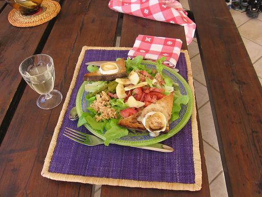

## Ingrédients (pour 4 personnes)

- une salade type feuilles de chêne
- 150 g de lardons fumés
- 4 toasts
- 8 rondelles de fromage de chèvre
- une petite boîte de thon à l’huile et au citron de la Belle-Isloise
- un petit pot d’asperges vertes
- 4 cuillers de vinaigrette
- 4 rondelles de tomate
- 4 rondelles de pomme

## Préparation

- faire préchauffer le grill du four
- mettre les toast avec le fromage de chèvre à griller
- dresser les assiettes et servir aussitôt

## Observations

- recette préparée le 2 novembre 2006 à Porticcio. Excellente
