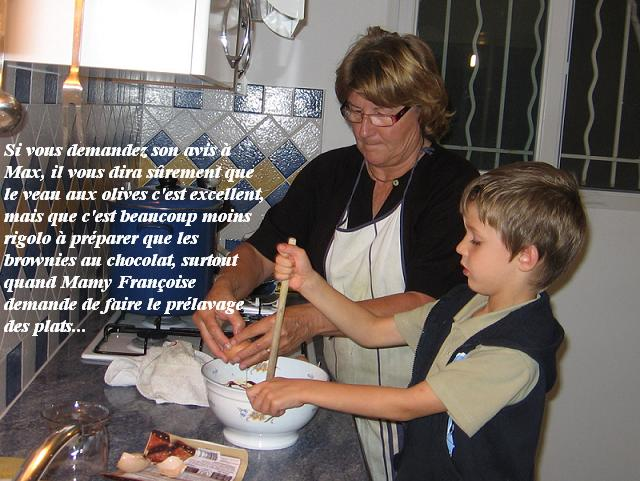

*Pour 4 personnes*

## Ingrédients

- 1 kg de poitrine de veau coupée en morceaux
- 125 g d'olives vertes dénoyautées
- 125 g de petits lardons (fumés ou nature)
- 400 g de carottes
- 400 g de champignons de Paris entiers (en boîte ou frais)
- 1 gros oignon jaune
- 10 petits oignons blancs (grelots)
- 3 gousses d'ail
- 1 c. à soupe de concentré de tomates
- 1 c. à café de fécule de maïs (Maïzena) ou de farine
- 1 grand verre de vin blanc sec
- 1 c. à soupe d'huile d'olive
- Thym, romarin, laurier
- Sel et poivre du moulin

## Préparation

1. Éplucher et émincer le gros oignon ainsi que les gousses d'ail.
2. Éplucher les carottes et les tailler en rondelles régulières.
3. Dans une grande cocotte en fonte, faire chauffer l'huile et faire dorer les morceaux de veau avec les lardons sur toutes leurs faces.
4. Ajouter l'ail et l'oignon émincés, remuer et laisser blondir à feu moyen pendant quelques minutes.
5. Saupoudrer de farine (ou fécule) et ajouter le concentré de tomates en remuant pour bien enrober la viande.
6. Mouiller avec le vin blanc sec et un volume équivalent d'eau tiède, puis mélanger pour décoller les sucs de cuisson.
7. Ajouter le thym, le romarin, le laurier, une pincée de sel et quelques tours de moulin à poivre.
8. Couvrir la cocotte et laisser mijoter à feu très doux pendant 1 heure.
9. Blanchir les olives vertes 1 minute dans une casserole d'eau bouillante pour atténuer leur amertume et leur excès de sel, puis les égoutter.
10. Ajouter dans la cocotte les olives blanchies, les carottes en rondelles, les petits oignons grelots et les champignons.
11. Poursuivre le mijotage à couvert et à feu doux pendant 1 heure supplémentaire jusqu'à ce que la viande soit parfaitement fondante.

## Observations

- **Contexte :** Recette réalisée le 1er novembre 2006 à Porticcio et servie accompagnée de spaghetti frais ; un plat d'une saveur exceptionnelle !
- **Rencontres lavalloises :** Le 2 décembre 2006 se tenait à Rennes une session des rencontres culinaires lavalloises regroupant 13 convives (Denise et Jean-Claude de Belleuse, Annie et Daniel de Laval, Andrée et Michel de Laval, Claire, Maurice et Julie de Villiers-Charlemagne, Pierre et Anne de Vitré, Mamy et moi). Nous avons cuisiné à cette occasion une variante adaptée pour grande tablée (cf. recette n°111).
