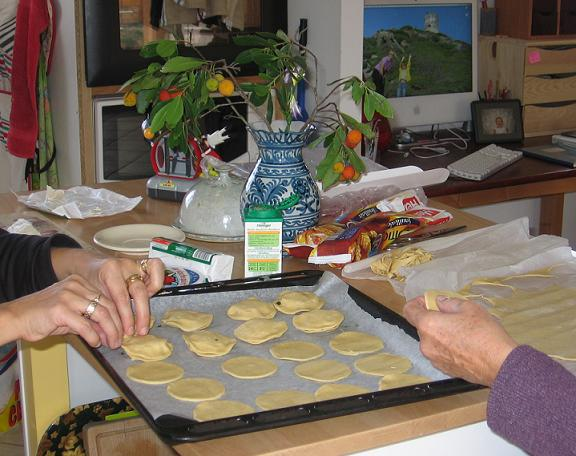

## Ingrédients

- 2 rouleaux de pâte feuilletée pur beurre
- 1 bûche de fromage de chèvre
- 20 belles feuilles de basilic frais
- 1 jaune d'œuf pour la dorure

## Préparation

1. Dérouler la première pâte feuilletée et y découper une dizaine de disques à l'aide d'un emporte-pièce ou d'un verre. Faire de même avec le second rouleau (20 disques au total).
2. Préchauffer le four à 220°C (425°F).
3. Découper la bûche de chèvre en 10 rondelles épaisses (retirer la croûte au préalable si souhaité).
4. Déposer une feuille de papier cuisson sur la plaque du four et y disposer 10 premiers disques de pâte.
5. Déposer au centre de chaque disque une rondelle de chèvre et recouvrir de deux feuilles de basilic frais.
6. Humecter légèrement le pourtour à l'eau, puis recouvrir chaque bouchée d'un second disque de pâte en pinçant fermement les bords pour bien souder.
7. Badigeonner la surface au pinceau avec le jaune d'œuf délayé d'une goutte d'eau.
8. Enfourner et surveiller attentivement la cuisson pendant 15 à 20 minutes jusqu'à ce que les feuilletés soient gonflés et bien dorés.
9. Servir aussitôt à la sortie du four, accompagnés d'une salade verte bien assaisonnée.

## Observations

- **Contexte :** Recette exécutée à Porticcio le 6 novembre 2006 ; de petits feuilletés croustillants et parfumés, absolument délicieux !
