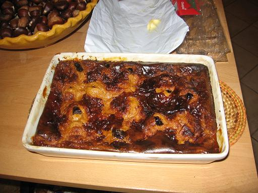

## Ingrédients

Cette recette est identique à celle de la recette du fars de Tante Pierrette (cf recette n°7) mais on apporte les modifications suivantes :
- on ajoute de la chicorée (liquide ou en poudre) au lait, ce qui permet de donner un caractère "chti" au far
- on utilise des produits corses en ce qui concerne les oeufs et les puneaux
- pour ne pas que l'aspect breton disparaisse, on remplace la farine de froment par un mélange 50/50 de farine de blé noir et de farine de froment.

## Préparation

Comme indiqué ci-dessus, cette recette est identique à celle de la recette du fars de Tante Pierrette (cf recette n°7)

## Observations

Cette recette a été exécutée le 2 novembre 2006 à Porticcio ; excellente !
