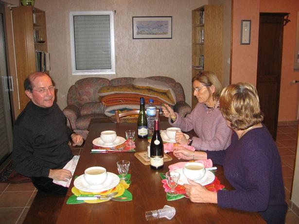
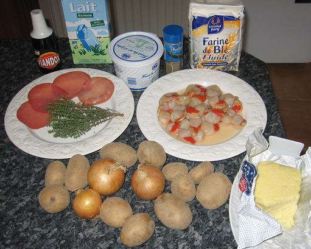

## Ingrédients (pour 6 personnes)

- 10 grosses de pommes de terre à frites
- 400 à 500 g de coquilles (noix de St-Jacques, palourdes, praires)
- 3 cuillers à soupe de farine
- 3 gros oignons
- une branche de thym
- 4 tranches de bacon fumé
- 1 litre de lait
- 50 à 100 g de beurre
- sel, poivre selon goût
- 20 cl de crème fraîche
- une cuiller à soupe de viandox

## Préparation

- peler et découper en tranches les oignons et les faire revenir dans le beurre sans les noircir
- faire revenir aussi les tranches de bacons
- mettre la farine et remuer une minute sur feu doux
- mouiller progressivement avec le lait, remuer, chauffer à feu doux
- ajouter de l'eau si c'est trop épais
- peler et débiter la moitié des pommes de terre, les mettre à cuire dans la préparation en remuant de temps en temps
- mettre le thym et le viandox, remuer et continuer à chauffer
- poivrer selon goût
- quand les pommes de terre sont cuites, passer le tout au mixer
- peler les pommes de terre restantes et les découper en petits cubes de 1 cm3
- les mettre à cuire à feu doux dans le bouillon mixé
- quand elles sont cuites, mettre les coquillages dedans (attention, ils ne doivent pas cuire plus de 5 ou 6 mn, sinon ils seront durs)
- saler selon goût, mettre la crème fraîche, réchauffer si nécessaire, mais sans recuire
- servir aussitôt

## Observations

1 -  recette inspirée de celle du "New England clam chowder"
2 - exécutée le 14 novembre 2006 à Quiberon pour M. et Mme Michel Pioger et nous deux. Bien   appréciée quoiqu'un peu trop poivrée
3 - les pommes de terre peuvent ne pas être des pommes pour frites, mais on risque alors de voir les petits cubes se déliter
4 - attention à ne pas dépasser la quantité de farine car cela épaissit énormément la préparation et a tendance à coller au fond de la casserole.
